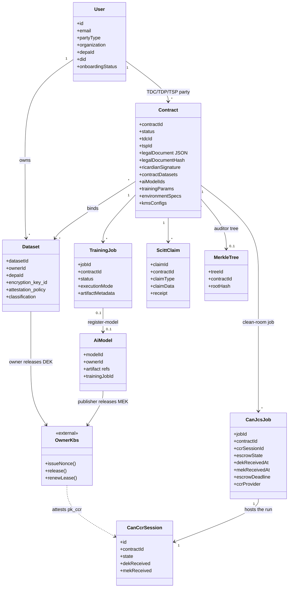
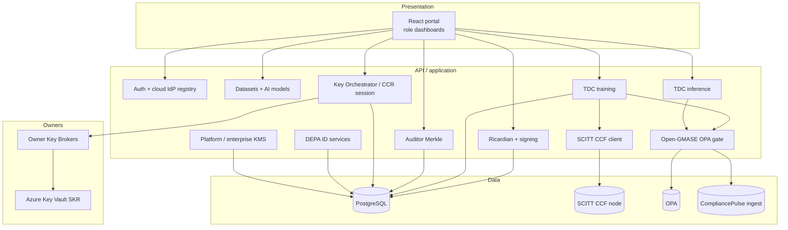
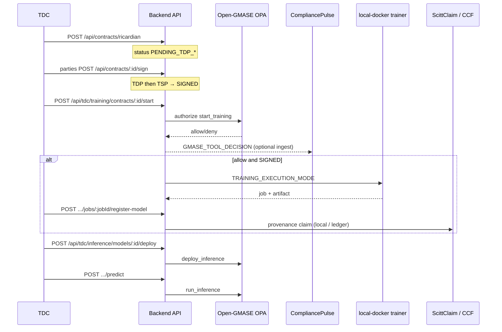
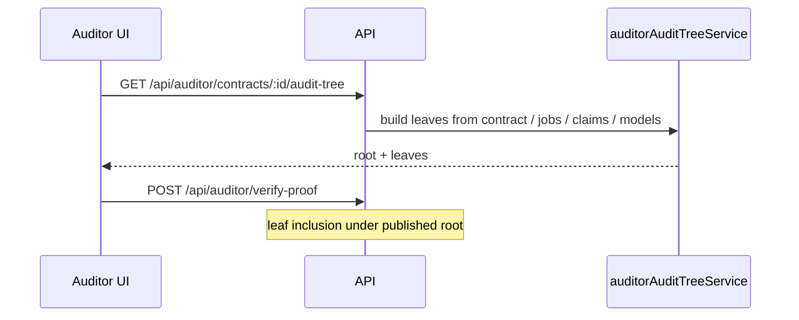
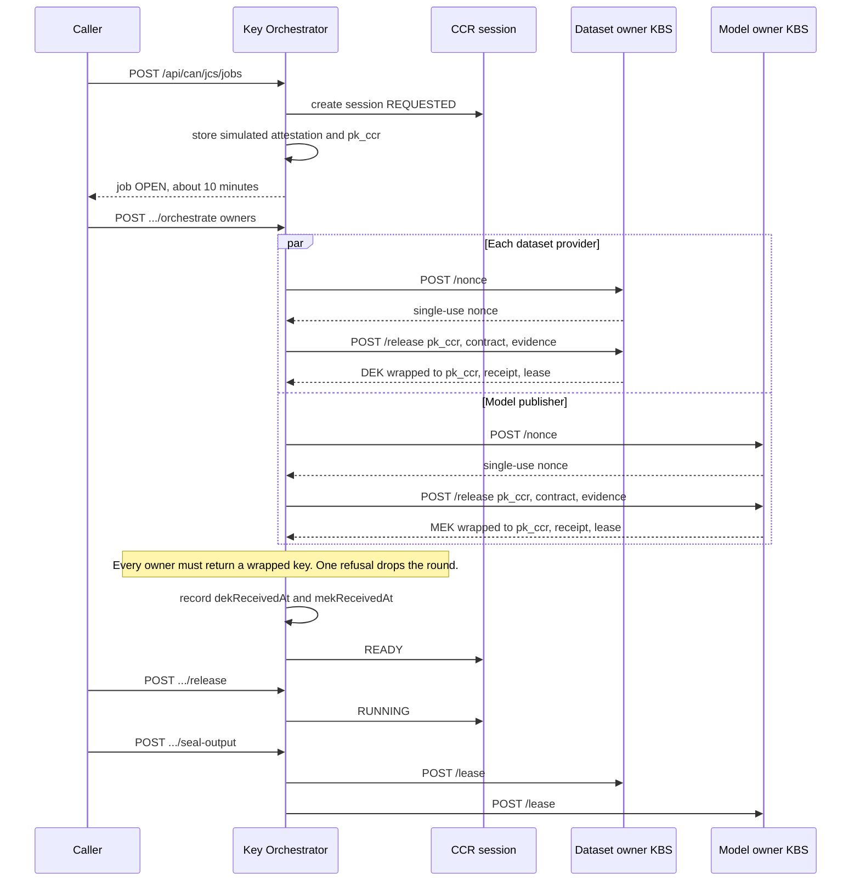
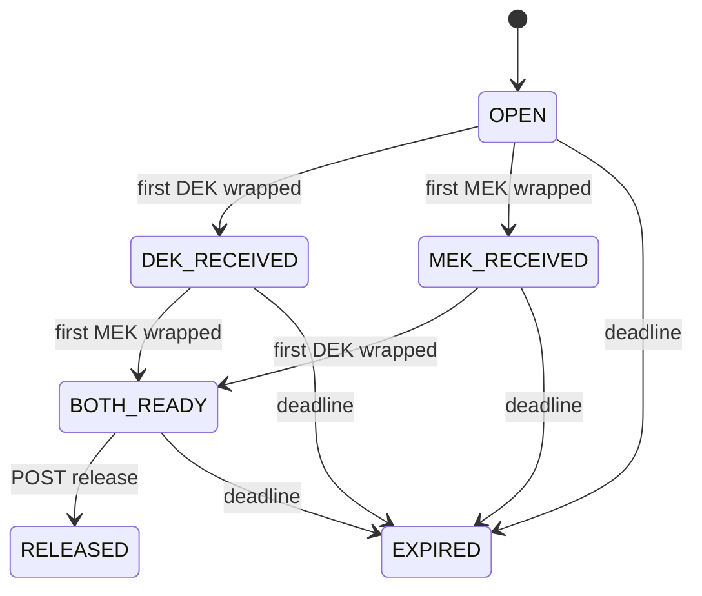
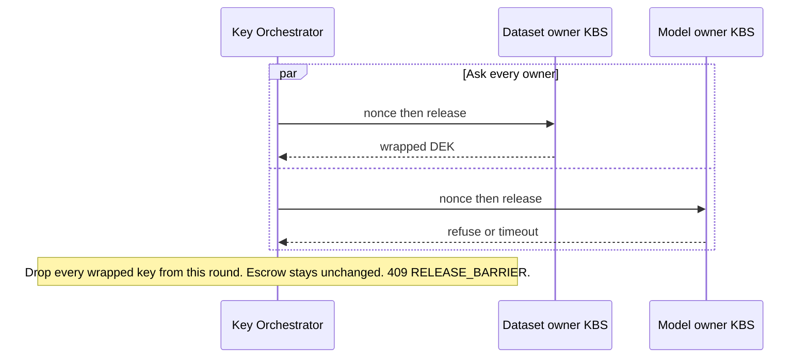
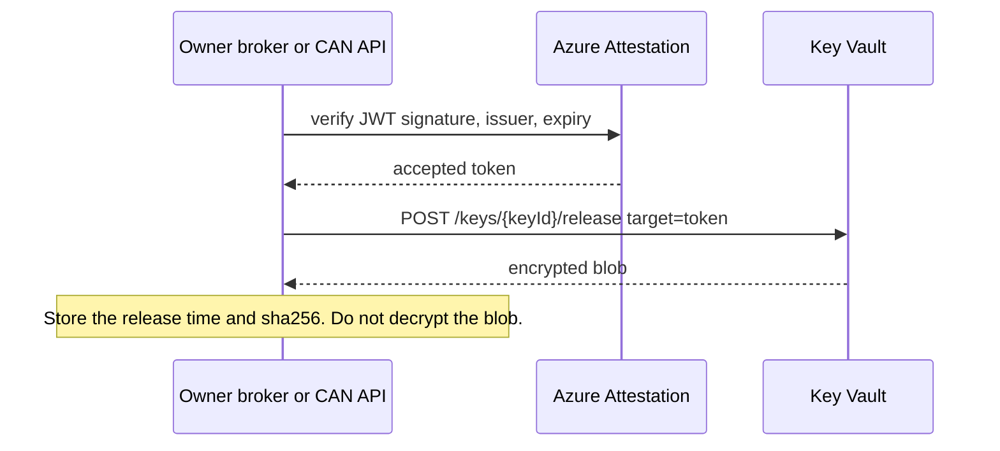
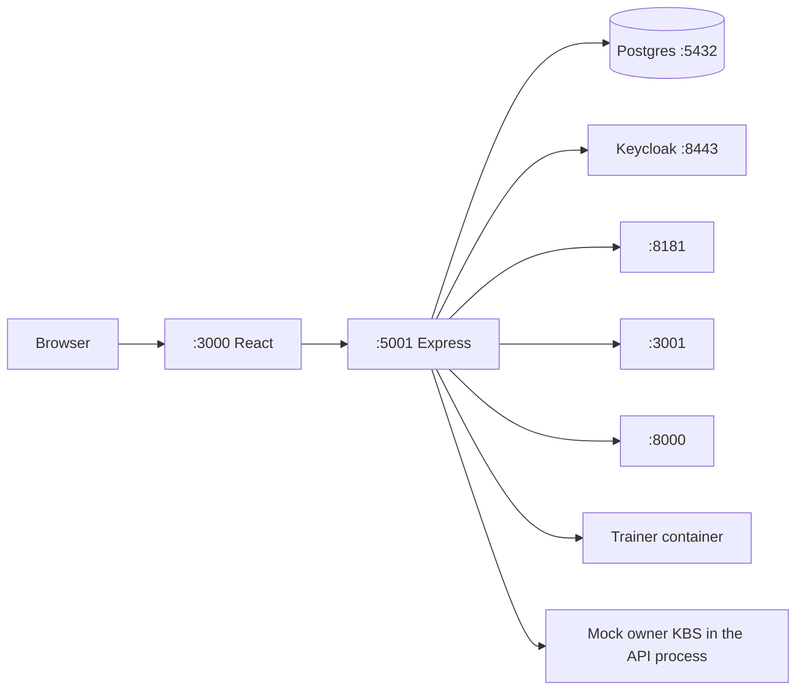
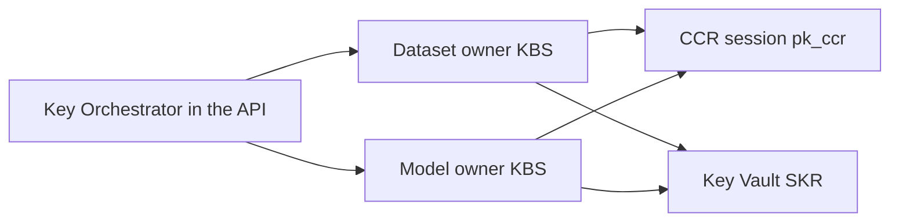

# UML 4+1 architecture — Confidential AI Network

| Field | Value |
|-------|--------|
| **Version** | 4.1 |
| **Last updated** | 2026-11-24 |
| **Scope** | Logical, process, development, physical, and scenario views aligned to the current monorepo |
| **Maturity** | Local stack primary; Azure/OCI IaC partial |

Kruchten [4+1](https://en.wikipedia.org/wiki/4%2B1_architectural_view_model) for **Confidential AI Network (CAN)**: logical, process, development, physical, and scenarios.

**Related:** [docs/ARCHITECTURE.md](../ARCHITECTURE.md) · [Datasets, models, and the clean room](../USER_GUIDE.md#datasets-models-and-the-clean-room) · [Ricardian contracts](../contracts/RICARDIAN_CONTRACT_GUIDE.md) · [Azure security](../production/AZURE_SECURITY_ARCHITECTURE.md) · [Multi-cloud patterns](../production/MULTI_CLOUD_SECURITY_ARCHITECTURE_PATTERNS.md) · [NIST/CIS/OWASP map](../compliance/SECURITY_CONTROLS_NIST_CIS_MAPPING.md)

---

## Conventions

| Label | Meaning |
|-------|---------|
| **Live** | Implemented and runnable on the local stack (or covered by e2e) |
| **Pilot** | Cloud IaC / integration present; operator follow-through required |
| **Design** | Specified target; not yet mounted or not yet deployed |
| **Legacy** | Retained for compatibility |

**Identity:** Local = Keycloak (`AUTH_PROVIDER=keycloak`, HTTPS `:8443`). Azure = Microsoft Entra. OCI = IAM Identity Domains. Keycloak is local-only.

**Roles:** `TDP` | `TDC` | `TSP` | `AppAdmin` | `Auditor`. `CCRP` aliases `TSP` (`/api/ccrp` → TSP router; `/ccrp/*` → `/tsp/*`).

---

## 1. Logical view

Object model and service boundaries as the application layer sees them.

### 1.1 Domain model (core)



`encryption_key_id`, `attestation_policy`, and `kmsConfigs` are stored references. They are not a Key Broker address. The caller of `POST /api/can/jcs/jobs/{jobId}/orchestrate` passes each dataset owner as `{ ownerId, keyType: "DEK", endpoint }` and the model publisher as `{ ownerId, keyType: "MEK", endpoint }`. The tech service provider hosts `CanCcrSession` and does not hold either key.

**Contract status (primary):** `PENDING_TDP(_APPROVAL)` → `PENDING_TSP(_APPROVAL)` → **`SIGNED`** → `EXECUTING` → `COMPLETED` | `FAILED` | `REJECTED`. Legacy DB values `PENDING_CCRP*` map to TSP states.

**Ricardian binding:** Human-readable `legalDocument` hashed to `legalDocumentHash`; machine fields (`contractDatasets`, `trainingParams`, `environmentSpecs`, `kmsConfigs`) drive runtime gates. Create path is **`POST /api/contracts/ricardian` only** (plain `POST /api/contracts` rejected).

### 1.2 Logical packages



### 1.3 API surface (mounted)

| Prefix | Responsibility | Maturity |
|--------|----------------|----------|
| `/api/auth`, `/api/users` | Session / profile | Live |
| `/api/contracts` | Ricardian create, party sign, lifecycle | Live |
| `/api/signing` | Party signing keys / enterprise KMS hooks | Live (crypto verify often Phase target) |
| `/api/datasets`, `/api/ai-models` | Catalog | Live |
| `/api/tdc/training` | Start train, jobs, register-model | Live |
| `/api/tdc/inference` | Deploy + predict | Live |
| `/api/tdp`, `/api/tdc`, `/api/tsp`, `/api/admin`, `/api/auditor` | Role APIs | Live |
| `/api/scitt-ccf` | Ledger client + local claims | Live (local node) |
| `/api/can/jcs`, `/api/can/ccr`, `/api/can/provenance` | Job, clean-room session, orchestrate, renew-leases, azure-key-release, seal-output | Live. Local broker is mock. Azure SKR is off unless `CAN_PRINCIPAL_KEY_MODE=azure-skr` |
| `/api/depa` | DEPA entity IDs | Live |
| `/api/platform-encryption`, `/api/enhanced-encryption` | Encryption helpers | Live |
| `/api/infrastructure` | Cloud credential / infra stubs | Partial |
| `/api/blockchain` | Legacy | Legacy (`BLOCKCHAIN_ENABLED=false`) |
| `/api/training`, `/api/provenance`, `/api/tee`, `/api/multi-cloud-tee`, `/api/marketplace` | Older surfaces | **Disabled** in `server.js` |

Primary modules: `backend/services/ricardianContractService.js`, `training/tdcTrainingExecutionService.js`, `shared/services/gmaseOpaService.js`, `shared/services/gmaseSideEffectGate.js`, `inference/backend/localInferenceService.js`, `auditorAuditTreeService.js`, `scittCcfService.js`, `canJcsService.js`, `backend/sdk/owner-kbs.js`, `keyReleaseClient.js`, `hpke.js`, `azureKeyRelease.js`, `keycloakService.js`, `cloudIdpRegistry.js`.

---

## 2. Process view

Concurrency and control flow for the paths that ship.

### 2.1 Primary: Ricardian → SIGNED → train → register → infer



| Gate | Env | Default |
|------|-----|---------|
| Training start | `GMASE_TRAINING_GATE` | on |
| Deploy / predict | `GMASE_INFERENCE_GATE` | on |
| OPA | `OPA_URL` (default `http://localhost:8181`), package `open_gmase/can_contracts` | |
| CP forward | `COMPLIANCEPULSE_INGEST_URL` (default `http://localhost:3001`; `false` disables) | |

Training modes: `TRAINING_EXECUTION_MODE=local-docker` (default) | `local-native` | `local-mlx`. Cloud Job runners (e.g. OKE) exist as providers; confidential TEE pools remain **Design**. This portal sequence does not create a CAN job and does not call an owner Key Broker. The clean-room handshake is §2.3.

### 2.2 Auditor Merkle verification



Auditor APIs: `/api/auditor/*`. Legacy `/api/provenance` is unmounted.

### 2.3 Clean room: dataset owners, model owner, session, brokers

This path runs beside the portal training path. The contract must already name the datasets, the base model, and the tech service provider. The provider hosts the room and does not hold the data key or the model key. Principals call the API with `X-CAN-Principal-Id`.

The catalog does not select a broker. `encryption_key_id`, `attestation_policy`, and `kmsConfigs` stay on the row. The caller of `orchestrate` passes `owners`.



Order of work:

1. `POST /api/can/jcs/jobs` with `contractId` and `ccrProvider` opens the job in `OPEN` and a clean-room session in `REQUESTED`. The attestation bundle and the one-run public key belong to that session. Locally the report is simulated and the HPKE private key stays in the API process.
2. `POST /api/can/jcs/jobs/{jobId}/orchestrate` asks every dataset owner and the model publisher in parallel. Each call is nonce, then release. Two datasets from one provider are one data-key owner. Two providers are two data-key owners.
3. The job stores one `dekReceivedAt` and one `mekReceivedAt`, and only after every owner in that request returned a key wrapped to `pk_ccr`. The session moves to `READY`.
4. `POST .../release` is accepted only in `BOTH_READY`. The job becomes `RELEASED` and the session becomes `RUNNING`.
5. `POST .../seal-output` records ciphertext and a sha256 while the escrow deadline and the owner leases are open. `POST .../renew-leases` extends each lease. One owner who will not renew blocks sealed output.
6. After the deadline the job is `EXPIRED` or `CANCELLED` and the session is destroyed. A later release is refused.

`POST .../key-released` is the older direct signal. The dataset owner and the model owner each wrap a key to `tlsPublicKey`. The same two timestamps move the job. Portal **Start training** does not use either call.

### 2.4 Escrow and session states



The clean-room session follows the job: `REQUESTED` at create, `READY` at `BOTH_READY`, `RUNNING` at `RELEASED`. Expiry destroys the session.

### 2.5 One owner refuses



A revoked or expired contract, a replayed nonce, an unbound report, or an exhausted release budget is the same outcome. The orchestrator does not decide trust. The broker does.

### 2.6 Azure Secure Key Release for one owner

Used only when `CAN_PRINCIPAL_KEY_MODE=azure-skr`. The other owners in the same run can still use their own brokers.



`POST /api/can/jcs/jobs/{jobId}/azure-key-release` is that call on the API. A missing `AZURE_ATTESTATION_URL`, a simulated report, or a mock key id returns no key.

### 2.7 Design / unmounted process paths

| Path | Status |
|------|--------|
| `/api/marketplace` | Unmounted |
| `/api/multi-cloud-tee` | Unmounted |
| `/api/tee` | Unmounted |
| Ethereum ledger | `BLOCKCHAIN_ENABLED=false` |

See `docs/production/` and provider stubs for the Design narrative.

---

## 3. Development view

Module organization for implementers.

### 3.1 Monorepo

```text
Confidential-AI-Network/
├── frontend/                 # React 18 + MUI + CRA (:3000)
├── backend/                  # Express + Sequelize + pg (:5001)
│   ├── routes/               # platform routers (mounted in server.js)
│   ├── services/             # platform services, key release, HPKE, Azure SKR
│   ├── sdk/owner-kbs.js      # owner broker the orchestrator calls
│   ├── models/
│   ├── middleware/
│   └── local-training/       # trainer image and run outputs (train.py)
├── training/                 # TDC training routes, runners, and Training page
├── inference/                # TDC inference routes, infer.py, and Inference page
├── shared/
│   ├── services/             # cloud account + GMASE gate used by training and inference
│   └── valueObjects/         # contract id, money, duration
├── open-gmase-core/          # OPA policies, SPIFFE scaffolds, Compose (OPA :8181)
├── compliancepulse-ai/       # control-plane (ingest :3001)
├── deployment/
│   ├── azure/terraform/      # pilot: networking, AKS, Entra, KV, Blob, WI
│   └── oci/terraform/        # OKE, IAM Domains, optional SCITT/SPIRE/Vault
├── docker/                   # postgres, Keycloak, SCITT CCF compose
├── scitt-ccf/                # ledger packaging / ops notes
├── blockchain/               # Hardhat legacy
├── docs/                     # architecture, security, blogs (GitHub Pages)
└── scripts/                  # start-system, auth fix, e2e helpers
```

Platform code stays in `backend/` and `frontend/`. TDC training and inference sit beside them. `backend/server.js` mounts `training/routes.js` at `/api/tdc/training` and `inference/backend/routes.js` at `/api/tdc/inference`.

### 3.2 Frontend structure (roles)

| Area | Path |
|------|------|
| Routing | `frontend/src/App.js` |
| Dashboards | `frontend/src/pages/dashboards/*` |
| TDC | `/tdc/*` — contracts, training, inference, models |
| TDP | `/tdp/*` — datasets, contracts |
| TSP | `/tsp/*` — credentials, environments, contracts |
| AppAdmin | `/admin/*` |
| Auditor | `/auditor/*` — audit-tree |
| Ricardian create | `/contracts/create-ricardian` |

### 3.3 Cross-cutting libraries

| Concern | Location |
|---------|----------|
| OPA side-effect gate | `shared/services/gmaseOpaService.js`, `shared/services/gmaseSideEffectGate.js`, `open-gmase-core/.../can-contracts.rego` |
| Merkle / proofs | `MerkleTreeBuilder.js`, `ProofGenerator.js`, `auditorAuditTreeService.js` |
| Cloud IdP | `cloudIdpRegistry.js`, `entraIdentityService.js`, `ociIdentityService.js` |
| Providers | `services/providers/{aws,azure,gcp,oci}Provider.js` |
| Key Orchestrator | `backend/services/canJcsService.js` (`createJob`, `orchestrateOwners`, `renewOwnerLeases`) |
| Owner Key Broker | `backend/sdk/owner-kbs.js` (`MockOwnerKbs`, `ProductionOwnerKbs`, `HttpOwnerKbsClient`) |
| Release policy and cloud brokers | `keyReleaseClient.js`, `keyReleasePolicy.js`, `azureKeyRelease.js`, `cloudKeyRelease.js`, `hpke.js`, `keyLease.js`, `releaseReceipt.js` |

---

## 4. Physical view

Topology for local, Azure pilot, and OCI.

### 4.1 Local (primary demo)



Typical bring-up: `./start-system.sh` (or compose under `docker/`) + `cd open-gmase-core && docker compose up -d` + CompliancePulse when testing ingest. SCITT optional via `docker/docker-compose.scitt-ccf-dev.yml`. Local key release uses the mock broker. The HPKE private key for a clean-room session stays in the API process. A production profile refuses that mock.

### 4.1a Owner brokers and Azure Key Vault



Each broker is the owner's process, or `endpoint: mock` on the local stack. Key Vault is called only for an owner whose key is released with `azure-skr`. The vault returns an encrypted blob to the attested guest. The API stores the time and the blob hash.

### 4.2 Azure pilot

Terraform under `deployment/azure/terraform/`:

| Module | Default |
|--------|---------|
| Networking, AKS (OIDC/WI), Postgres, ACR, LB, Entra app roles | on |
| Key Vault, Blob, workload identity (UAMI + FIC + RBAC) | on |
| Front Door / WAF, SPIRE namespace | off |
| Confidential compute pool, SCITT on Azure, APIM JWT code | **not** in TF / Design |
| Key Vault secure key release | API path live, off unless `CAN_PRINCIPAL_KEY_MODE=azure-skr` |

See [AZURE_READINESS.md](../deployment/AZURE_READINESS.md). Human IdP = Entra only.

### 4.3 OCI

Terraform under `deployment/oci/terraform/`: OKE, IAM Domains, OCIR, optional Vault / WIF / SPIRE / SCITT / training Job. Human IdP = OCI IAM (no Keycloak on cluster).

### 4.4 Trust planes (deployment-shaped)

```text
Humans     → cloud IdP (or Keycloak local)
Cloud APIs → workload identity / WI / instance principal
Peers      → SPIFFE/SPIRE where enabled (scaffold / opt-in)
Evidence   → ScittClaim rows + optional CCF node; Auditor Merkle roots
Keys       → each owner's Key Broker; the clean-room session holds pk_ccr for the run
```

SPIFFE/SPIRE covers workload identity. The Key Orchestrator asks dataset brokers and the model broker. Azure Secure Key Release returns an encrypted blob after an Azure Attestation token verifies ([AZURE_SPIFFE_SPIRE_WIF.md](../deployment/AZURE_SPIFFE_SPIRE_WIF.md), [AZURE_SECURITY_ARCHITECTURE.md](../production/AZURE_SECURITY_ARCHITECTURE.md)). A simulated report is not that token.

---

## 5. Scenarios (+1)

### S1 — Multi-party Ricardian agreement

1. TDC creates contract via `POST /api/contracts/ricardian` (+ UI preview).
2. TDP and TSP sign (`POST /api/contracts/:id/sign`).
3. Status reaches **`SIGNED`** (training gate).

### S2 — Governed local training

1. Preconditions: `SIGNED`; OPA reachable when gates are enabled.
2. `POST /api/tdc/training/contracts/:contractId/start`.
3. Job completes under `TRAINING_EXECUTION_MODE`; register model; local SCITT claim written.

### S3 — Governed inference

1. Deploy model → OPA `deploy_inference`.
2. Predict → OPA `run_inference`.
3. Decisions in AuditLogs; optional CompliancePulse ingest (decision metadata).

### S4 — Auditor inclusion proof

1. Open `/auditor/contracts/:id/audit-tree`.
2. `POST /api/auditor/verify-proof` against the published root.
3. Confirms leaf inclusion (lineage), not semantic model evaluation.

### S5 — Dataset, model, and clean-room key release

1. The signed contract names one to three datasets, a base model, and the tech service provider who will host the room.
2. `POST /api/can/jcs/jobs` creates the job (`OPEN`) and the clean-room session (`REQUESTED`), with a simulated attestation and `pk_ccr`.
3. `POST .../orchestrate` sends one DEK owner per dataset provider and one MEK owner for the model publisher. Each broker receives a nonce, then the evidence, `pk_ccr`, and the contract.
4. Every broker returns a wrapped key, a signed receipt, and a lease. The job records `dekReceivedAt` and `mekReceivedAt`. The session becomes `READY`.
5. `POST .../release` moves the job to `RELEASED` and the session to `RUNNING`.
6. `POST .../seal-output` records sealed ciphertext while the deadline and the leases are open. `POST .../renew-leases` extends those leases.
7. The deadline moves the job to `EXPIRED` and destroys the session. A later key is refused.

### S6 — One owner uses Azure Secure Key Release

1. That owner's broker, or `POST .../azure-key-release` when `CAN_PRINCIPAL_KEY_MODE=azure-skr`, presents an Azure Attestation JWT.
2. The API checks the token against `AZURE_ATTESTATION_URL`.
3. Key Vault `/keys/{keyId}/release` returns an encrypted blob. The API stores the time and the sha256.
4. The other owners in the same job still use their own brokers. A missing token or a simulated report returns no key.

### S7 — One broker refuses

1. The orchestrator has already asked the other owners.
2. One broker refuses, times out, or rejects the contract, nonce, or budget.
3. Every wrapped key from that round is dropped. Escrow stays where it was. The API returns 409 `RELEASE_BARRIER`.

---

## 6. Architecture decisions

| Decision | Choice | Notes |
|----------|--------|-------|
| Ledger | SCITT CCF + local `ScittClaim` | Ethereum path legacy/off |
| Contract create | Ricardian-only API | Legal prose + machine binding |
| Train gate | `status === SIGNED` + OPA | TDC sign not required for start |
| Signing verify | Authz gate live; crypto verify / Key Vault target | |
| DEK/MEK | Dataset owner holds the DEK. Model publisher holds the MEK. Caller passes both brokers. | Job stores one time for each. Catalog key id is not the broker. |
| Clean-room session | Created with the CAN job. TSP hosts it. | `REQUESTED` → `READY` → `RUNNING`. Brokers attest `pk_ccr`. |
| Key Orchestrator | Coordinates. Does not decide trust. | Parallel nonce and release. One refusal drops the round. |
| Azure SKR | Off unless `CAN_PRINCIPAL_KEY_MODE=azure-skr` | Encrypted blob after an Azure Attestation JWT. API does not decrypt it. |
| Cloud IAM | Entra / OCI IAM / … | Keycloak local-only |
| TEE marketplace APIs | Unmounted | Design |

---

## 7. Document history

| Version | Date | Change |
|---------|------|--------|
| 3.x | 2025-01 | Earlier CMS + SCITT-centric UML |
| **4.0** | **2026-08-18** | CAN roles, Ricardian→train→infer+OPA/CP, Auditor Merkle, Azure/OCI topology |
| **4.1** | **2026-11-24** | Sequence for dataset owners, the model publisher, the clean-room session, owner brokers, refusal, and Azure SKR |
