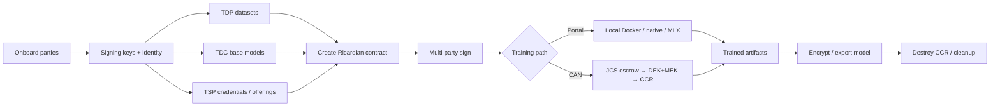

# Participant Onboarding & End-to-End Lifecycle

**Canonical guide** for how parties join the Confidential AI Network (CAN) / Contract Management System and run a complete cycle: onboard → publish datasets & base models → create & sign contracts → name the existing clean room → encrypt/decrypt assets → train → export encrypted results → tear down.

This document **unifies** material previously spread across user guides, flow specs, CAN memos, signing docs, and training runbooks. Where portal (CMS) and CAN paths differ, both are called out explicitly.

| Item | Value |
|------|--------|
| Audience | Operators, integrators, AppAdmins, demo facilitators |
| Status | Reflects code + design as of 2026-11 |
| Companion demo | [LOCAL_DEMO_RUNBOOK.md](../training/LOCAL_DEMO_RUNBOOK.md) |
| Glossary | [GLOSSARY.md](../GLOSSARY.md) |
| Azure features & settings | [AZURE_FEATURES_AND_CONFIGURATION.md](../deployment/AZURE_FEATURES_AND_CONFIGURATION.md) — Entra, KV, DEK/MEK, train, Blob, SCITT |
| OCI features & settings | [OCI_FEATURES_AND_CONFIGURATION.md](../deployment/OCI_FEATURES_AND_CONFIGURATION.md) |
| AWS features & settings | [AWS_FEATURES_AND_CONFIGURATION.md](../deployment/AWS_FEATURES_AND_CONFIGURATION.md) |
| GCP features & settings | [GCP_FEATURES_AND_CONFIGURATION.md](../deployment/GCP_FEATURES_AND_CONFIGURATION.md) |
| Azure crypto topology | [AZURE_SECURITY_ARCHITECTURE.md](../production/AZURE_SECURITY_ARCHITECTURE.md) §16 |

---

## 1. Purpose and naming

### 1.1 Parties

| Role | Meaning |
|------|---------|
| **TDP** | Training Data Provider — publishes datasets; approves use under contract |
| **TDC** | Training Data Consumer — creates contracts; supplies base models; receives trained outputs |
| **TSP / CCRP** | Tech Service Provider / Confidential Clean Room Provider — hosts isolated training (TEE, private cloud, or local Docker). UI/docs often say **CCRP**; DB/`partyType` use **TSP** (`ccrp_*` columns map to `tsp*`) |
| **AppAdmin** | Platform administrator — users, health, configuration |
| **Auditor** | Read-only reviewer — every contract, the sealed Merkle audit tree, and a provenance tombstone kept in this database |

### 1.2 Two execution paths (do not mix casually)

| Path | Namespace | Trust model | Typical use |
|------|-----------|-------------|-------------|
| **Portal / CMS** | `/api/*` + Keycloak UI | Human SSO; optional **platform-managed** encryption; local Docker training | Stakeholder demos, day-to-day portal |
| **CAN / JCS** | `/api/can/jcs/*`, `/api/can/ccr/*` | **Principal-owned** DEK/MEK; escrow gating; attested key delivery (**target**) | Confidential clean-room job coordination |

The CAN path records one data-key time and one model-key time. The Key Orchestrator asks each dataset owner's broker and the model publisher's broker. Locally that broker is the mock, the attestation bundle is simulated, and the HPKE private key stays in the API process. Azure Secure Key Release and attested TLS into a hardware TEE stay off unless selected ([CAN_GAP_DECISION_MEMO.md](../features/can/CAN_GAP_DECISION_MEMO.md)).

### 1.3 End-to-end at a glance



---

## 2. Trust and crypto model

### 2.1 Non-negotiables (CAN production target)

1. Platform must **not** hold principal-owned **DEK** (dataset) or **MEK** (model) plaintext.
2. Decryption happens **only inside the CCR/TEE**; keys must not persist to disk.
3. Key release is gated by **attestation** bound to an ephemeral CCR identity.
4. Training starts only after **both** DEK and MEK are released (**dual-key escrow**); hard timeout destroys the session.
5. Lifecycle events are append-only / tamper-evident (provenance / SCITT).

### 2.2 Crypto material by stage

| Stage | Material | Who holds | Portal today | CAN target |
|-------|----------|-----------|--------------|------------|
| Onboarding | Keycloak password; optional DID; DEPA ID | Human + IdP | Implemented | Same humans; separate machine principals |
| Contract signing | ECDSA-P256 / RSA UserKey; private key on UserKey row (Vault custody = target) | Party | Implemented (portal path) | Same for legal signatures |
| Dataset encryption | **DEK** (AES-256-GCM) | TDP / data principal | Platform encryption **or** design: TDP-local | Principal-owned only |
| Model encryption | **MEK** | TDC / model owner | Partial / platform path | Principal-owned only |
| Clean-room session | One-run `sk_ccr` / `pk_ccr` | The session. The TSP hosts it | HPKE key in the API process. Report stays simulated | Hardware TEE holds `sk_ccr` |
| Job escrow | DEK from each dataset owner, MEK from the model publisher | Owner brokers. The job stores the release time | Orchestrator and mock broker shipped. Caller passes `owners` | Same barrier. Quote verified before release |
| Ledger | Signature + SCITT claim/receipt | Parties + SCITT CCF | Implemented when SCITT enabled | Provenance events on job lifecycle |
| Cleanup | Session destroy + key zeroize | TSP / sweeper | Env status DESTROYED | Escrow expiry → DESTROYED |

### 2.3 Identity split

| Identity | Purpose |
|----------|---------|
| **Keycloak user** (`TDP` / `TDC` / `TSP` / `AppAdmin`) | Portal login, RBAC, human workflows |
| **DID** (`did:web` / `did:ethr` or system-generated) | Optional portable identity on User |
| **Signing key** (`UserKey` / enterprise key) | Ricardian contract digital signatures → SCITT |
| **CAN machine principal** (`did:can:dp:…`, `mo:…`, `ccrp:…`) | Job APIs; MVP: `X-CAN-Principal-Id` header only (no cert auth yet) |

---

## 3. Participant onboarding

### 3.1 Bootstrap (ops)

1. Start stack (`./start-system.sh` or production equivalent).
2. Ensure Keycloak realm is healthy; sync users if needed (`./fix-auth.sh`; from `backend/`: `npm run keycloak:sync`).
3. Optional: SCITT CCF for signature receipts (`SCITT_CCF_ENABLED`).
4. AppAdmin verifies health (`npm run status`).
5. For local training demos: build trainer image and set `TRAINING_EXECUTION_MODE` / `CAN_LOCAL_TRAINING_MODE` / `LOCAL_TRAINING_IMAGE`, then **restart backend** (see [LOCAL_DEMO_RUNBOOK.md](../training/LOCAL_DEMO_RUNBOOK.md)).

### 3.2 Human registration (all roles)

**UI:** `/register` — name, email, party type (**TDP / TDC / TSP** only), organization, **Signing algorithm** (party signing key).  
**API:** `POST /api/auth/register` — also accepts `AppAdmin` and `Auditor`; accepts legacy `CCRP` and normalizes to `TSP`. Optional body `signingAlgorithm` (`ECDSA-P256` \| `RSA-2048` \| `RSA-4096`).

| Attribute | Required | Notes |
|-----------|----------|-------|
| `name` | **Yes** | Display name |
| `email` | **Yes** | Unique; becomes Keycloak username |
| `partyType` | **Yes** | Canonical: `TDP` \| `TDC` \| `TSP` \| `AppAdmin` \| `Auditor`. API alias: `CCRP` → `TSP`. `Auditor` is not on the public form |
| `password` | Optional at register | Temp password often issued; **first-login change** expected |
| `organization` | Recommended | Enterprise context |
| `signingAlgorithm` | Recommended for TDP/TDC/TSP | Defaults to `ECDSA-P256`; creates active `UserKey` in the same transaction |
| `description`, `phoneNumber`, `website`, `location` | Optional | Profile |
| `existingDID` + `didVerificationSignature` | Optional | Bring-your-own DID; else system generates |
| `walletAddress`, `publicKey` | Optional | Legacy; not required for enterprise path |

**System-assigned (do not invent):**

| Attribute | Meaning |
|-----------|---------|
| `depaId` | DEPA-style party ID (e.g. `TDP-<uuid>`) |
| `iamUserId` / `iamUsername` | Keycloak linkage — registration fails if Keycloak is down |
| `did`, `didSource`, `didVerified` | DID lifecycle |
| `onboardingStatus`, `profileCompleted`, `firstLogin` | Onboarding state machine |
| `signingKeyCreated` (response) | `true` when a party signing key was minted for TDP/TDC/TSP |

### 3.3 Post-registration checklist (per role)

| Step | TDP | TDC | TSP/CCRP | AppAdmin |
|------|-----|-----|----------|----------|
| First password change | ✓ | ✓ | ✓ | ✓ |
| Complete profile / org | ✓ | ✓ | ✓ | ✓ |
| **Party signing key** (at register) | ✓ | ✓ | ✓ | Optional |
| Configure cloud credentials | — | — | ✓ | — |
| Publish dataset(s) | ✓ | — | — | — |
| Publish / select base model(s) | — | ✓ | — | — |
| Verify DEPA ID visible on profile | ✓ | ✓ | ✓ | ✓ |

### 3.4 Contract signing keys (required for E2E signing)

Without an active signing key, parties cannot create Ricardian contracts or complete cryptographic signatures (`SIGNING_KEY_REQUIRED`).

**Primary path (current):** choose **Signing algorithm** on `/register` (or pass `signingAlgorithm` on `POST /api/auth/register`). The backend creates an active `UserKey` for TDP / TDC / TSP before the user can create or sign contracts.

**Backfill / regenerate:** Profile / signing API → `POST /api/signing/keys/generate` with `algorithm` (`ECDSA-P256` recommended, RSA-2048, or RSA-4096). E2E helpers call this for seeded users that predate registration key minting.

**Current portal implementation:** `UserKey.privateKey` is stored on the user-keys row (intended to be encrypted at rest in production). Older signing guides that describe a separate Key Management unlock-password + Vault custody reflect **design / enterprise target**, not the default registration path.

| UserKey field | Required | Notes |
|---------------|----------|-------|
| `userId` | Yes | Owner |
| `keyId` | Yes | Stable key identifier |
| `keyType` | Yes | Algorithm family |
| `publicKey` | Yes | Stored in DB |
| `privateKey` | Yes | DB column today; Vault-backed custody is the target architecture |
| `keyStatus` | Yes | `active` \| `inactive` \| `revoked` \| `expired` |

Details: [CONTRACT_SIGNING_USER_GUIDE.md](../features/contract-signing/CONTRACT_SIGNING_USER_GUIDE.md) (UX narrative) · `backend/models/UserKey.js` (schema truth).

---

## 4. TDP — datasets

### 4.1 Catalog attributes (API-required)

| Field | Required | Notes |
|-------|----------|-------|
| `datasetId`, `name`, `description` | **Yes** | Catalog identity |
| `category` | **Yes** | `Computer Vision` \| `Natural Language Processing` \| `Audio` \| `Tabular` \| `Multimodal` |
| `size`, `recordCount`, `price`, `license` | **Yes** | Commercial / sizing metadata |
| `ownerId` | **Yes** | Must be a TDP user |
| `data_classification` | **Yes** (default INTERNAL) | PUBLIC … TOP_SECRET |
| `encryption_at_rest`, `encryption_in_transit` | **Yes** (defaults) | Flags |
| `secure_enclave_required`, `attestation_required` | Defaults | TEE policy hints for contracts |
| `encryption_algorithm` | Default AES-256-GCM | |
| `encryption_key_id` | Optional | Reference to DEK / KMS key |
| `tags`, residency, access policy JSON | Optional | Governance |
| `depaId` | Auto | Dataset entity ID |

### 4.2 Physical artifacts (needed for real local training)

Upload under dataset **Training files** (Phase A local storage):

| Attribute | Notes |
|-----------|-------|
| `contentFormat` | `csv` \| `parquet` \| `image_folder` |
| File / folder payload | Stored under `backend/uploads/datasets/…` |
| Artifact count | Must be &gt; 0 for customer-data training; else trainer may fall back to public demos |

See [PHASE_A_LOCAL_ARTIFACTS.md](../training/PHASE_A_LOCAL_ARTIFACTS.md).

### 4.3 Encryption options for datasets

| Mode | Who encrypts | Who holds DEK | Decrypt where | Maturity |
|------|--------------|---------------|---------------|----------|
| **A. Catalog only** | N/A | N/A | N/A | Metadata publish |
| **B. Platform encryption** | Platform on upload | Platform (`platformEncryptionService`) | Platform / trainer path | Implemented — **not** CAN end-state |
| **C. TDP local encrypt** | TDP before upload | TDP only | TEE after attested release | Design ([TDP_ENCRYPTED_DATASET_TEE_FLOW.md](../flows/TDP_ENCRYPTED_DATASET_TEE_FLOW.md)) |
| **D. LUKS large files** | Ops / TDP | Vault-backed | Mounted in secure env | Documented / partial |
| **E. CAN principal DEK** | TDP / DP principal | Principal | CCR via attested TLS | Target (Phase 2) |

**Clean-room rule (target):** ciphertext may be staged in object storage or pulled into CCR; **plaintext and DEK exist only inside the attested TEE** for the job window.

The dataset's `ownerId` is the data-key owner the clean room asks. `encryption_key_id` and `attestation_policy` are stored on the row. They are not a Key Broker address. When a contract selects this dataset, the caller of `POST /api/can/jcs/jobs/{jobId}/orchestrate` passes that owner as `{ ownerId, keyType: "DEK", endpoint }`. Two datasets from the same provider are one DEK owner. Two providers are two DEK owners, each with their own broker. The join with the model and the clean-room session is in [§9.4](#94-key-orchestrator).

---

## 5. TDC — base models

### 5.1 Catalog AIModel attributes (API-required)

| Field | Required | Notes |
|-------|----------|-------|
| `modelId`, `name`, `description` | **Yes** | |
| `type` | **Yes** | transformer \| cnn \| rnn \| gan \| other |
| `architecture`, `parameters` | **Yes** | |
| `framework` | **Yes** | PyTorch \| TensorFlow \| JAX \| Other |
| `privacyTechnique` | **Yes** | Declared PET |
| `validationMetrics` | **Yes** | Catalog metrics |
| `maxEpochs`, `batchSize`, `learningRate` | **Yes** | Default training hyperparameters |
| HF Hub refs | Optional (dev) | e.g. DistilBERT / AG News demos |
| `depaId` | Auto | AIMODEL entity |

### 5.2 Encrypted model upload

Optional path (`ai-models-upload`): upload weights + metadata; may use platform encryption.  
**CAN target:** TDC encrypts with **MEK** locally; only ciphertext enters the platform/CCR; MEK released to attested CCR after escrow.

The publisher of the model is the model-key owner. The orchestrator asks that owner's Key Broker with `{ ownerId, keyType: "MEK", endpoint }`. The model row does not store the broker URL. Portal **Start training** reads the artifact on this host and does not make that call. Details of the target upload flow: [TDC_ENCRYPTED_AI_MODEL_TEE_FLOW.md](../flows/TDC_ENCRYPTED_AI_MODEL_TEE_FLOW.md). The running handshake is [§9.4](#94-key-orchestrator).

---

## 6. TSP / CCRP — environment setup

### 6.1 Cloud credentials

TSP configures **cloud** credentials so contracts can select a clean-room backend. Secrets stay in an external secret manager — not in the DB.

| Field | Required | Notes |
|-------|----------|-------|
| `tspUserId` | **Yes** | TSP user |
| `cloudProvider` | **Yes** | `AWS` \| `AZURE` \| `GCP` \| `OCI` only on this model |
| `secretName` | **Yes** | Pointer into Vault / secret manager |
| `secretManager` | **Yes** | Which backend holds secrets |
| `authMethod` | Default | e.g. SERVICE_PRINCIPAL |
| Azure `subscriptionId`, `tenantId` | Per provider | |
| GCP `projectId` | Per provider | |
| OCI `compartmentId` | Per provider | |
| Infra defaults | Mostly defaulted | Region, VM size, VNet, encryption flags |

**Local Docker is not a `TSPCloudCredentials.cloudProvider` value.** Demo wizard uses **Local (Docker)** via contract/`cloudProviders` selection, typically with seeded **`ccrp.e2e@test.com`** (“CCRP E2E User”).

### 6.2 Environment offerings & lifecycle

1. TSP publishes **offerings** (regions, TEE types, pricing, isolation) for cloud paths.
2. `TrainingEnvironment` status (cloud/provisioned envs): `PENDING` → `PROVISIONING` → `ACTIVE` → `RUNNING` → … → `DESTROYING` → `DESTROYED`.
3. CAN CCR session states differ (e.g. `REQUESTED` → `ATTESTING` / `READY` / `RUNNING` / `DESTROYED`) — see `canJcsService.js`.
4. CAN escrow sweeper: deadline missed → session destroyed (key zeroize is design-level for real TEEs).

Flow detail: [CCRP_ENVIRONMENT_OFFERINGS_CONFIGURATION_FLOW.md](../flows/CCRP_ENVIRONMENT_OFFERINGS_CONFIGURATION_FLOW.md).

### 6.3 What to configure before contracts

| Checklist item | Local demo | Cloud pilot |
|----------------|------------|-------------|
| TSP user with signing key | ✓ | ✓ |
| Cloud = Local (Docker) or real provider | Local | Azure/OCI/etc. |
| Credentials + secret refs | Optional for local | Required |
| Trainer image built | `local-trainer` | Push to ACR/OCIR |
| Monitoring / budget limits | Optional | Recommended |

The TSP hosts the clean-room session. The TSP does not hold the dataset DEK or the model MEK. Creating a CAN job opens that session in `REQUESTED` and stores its id on the job. Brokers attest that session. They do not release a key to the TSP.

---

## 7. Contract creation

### 7.1 Who creates

**TDC** creates the Ricardian contract after datasets and (usually) base models exist.

### 7.2 Required / typical attributes

| Field | Required | Notes |
|-------|----------|-------|
| `datasetSelections[]` | **Yes** | 1–3 datasets: `datasetId`, `individualPrice` |
| Duration / legal terms | **Yes** | Template-driven |
| Price (derived) | **Yes** | Sum of dataset prices + fees |
| `tdcId` | From auth | Must be TDC |
| `tdpId` / multi-TDP | From datasets | Owners of selected datasets |
| `tspId` (CCRP) | Typical | Selected clean-room provider |
| `tspCloudProvider` / `environmentSpecs` | Typical | Local Docker or cloud specs |
| `kmsConfigs` | Typical for wizard | KMS provider placeholders for demo |
| `aiModelIds` | Typical | Base model(s) |
| `trainingParams` | Typical | Epochs, batch, DP flags (`differentialPrivacy`), `fastDevRun` |
| `depaId`, legal hash | Auto / optional | |

### 7.3 Status workflow (simplified)

```
DRAFT → PENDING_TDP (and/or multi-TDP) → PENDING_TSP → SIGNED → EXECUTING → COMPLETED
         ↘ REJECTED / FAILED
```

Exact enum also includes `PENDING_TDC` and multi-TDP statuses — see `backend/models/Contract.js`. There is **no** `CANCELLED` status on the current contract enum (use `REJECTED`).

---

## 8. Contract signing

### 8.1 Prerequisites

- All signing parties have an **active UserKey**.
- Contract is in a signable state (pending their signature).
- Optional: SCITT CCF reachable for receipts.

### 8.2 Procedure (each party)

1. Open contract → review terms, datasets, models, environment, privacy.
2. **Sign Contract** → uses the active registration **party signing key** → submit signature.
3. Receipt stored in SCITT when enabled (best-effort / path-dependent — signing can succeed even if SCITT is down on some routes).
4. Status advances when required parties have signed (typically **TDP(s)** then **TSP/CCRP**; training demos may not hard-gate on TDC signature).

### 8.3 Artifacts produced

| Artifact | Purpose |
|----------|---------|
| Digital signature | Binds party to Ricardian terms |
| SCITT claim / receipt | Tamper-evident ledger proof |
| Contract `SIGNED` | Enables training / CAN release |

---

## 9. Training execution

### 9.1 Portal path (implemented for demos)

1. Contract **SIGNED**.
2. TDC starts training job from UI.
3. The TSP provider chooses the runner. `TRAINING_EXECUTION_MODE` (`local-docker` \| `local-native` \| `local-mlx`) applies only when the provider is **Local**.
4. **Azure** and **GCP** submit to the cluster named on the contract (`environmentSpecs.cloudAccounts`) or, when a field is blank, on `users.cloud_account`. The kubeconfig path is the TSP dashboard field or `AZURE_CCR_KUBECONFIG` / `GCP_CCR_KUBECONFIG`. A missing path marks the job **FAILED** and does not create a cluster. Attestation on that submit is `simulated`.
5. **OCI** uses the existing OKE cluster. **AWS** returns 501 and does not write a job.
6. Trainer reads dataset artifacts (or demo fallback) + model config on the Local path.
7. Optional Opacus DP-SGD when `differentialPrivacy.enabled`.
8. Results → `TrainingJob` metadata / `metrics.json` under local runs.

**Scope:** Host Docker / native training is not a hardware TEE. Azure and GCP submit a Job spec to an existing cluster. See [TDC_TRAINING_RUNTIME.md](../training/TDC_TRAINING_RUNTIME.md) and [LOCAL_DEMO_RUNBOOK.md](../training/LOCAL_DEMO_RUNBOOK.md).

### 9.2 CAN / JCS path (MVP)

1. Create job: `POST /api/can/jcs/jobs` with `contractId`, `ccrProvider` (e.g. `local`). Header: `X-CAN-Principal-Id`.
2. Fetch the **attestation bundle**. On this path `reportFormat` is `SIMULATED` until a verified guest report is stored.
3. Data owner: wrap the DEK to `tlsPublicKey` (RSA-OAEP SHA-256) and `POST .../key-released` with `keyType: DEK`, `attestedPublicKey`, and `wrappedKey`.
4. Model owner: the same call with `keyType: MEK`.
5. Both releases move the job to `BOTH_READY`. `POST .../release` starts the local executor. One missing owner is `RELEASE_BARRIER`.
6. `POST .../seal-output` records sealed ciphertext and `outputSha256` while the escrow deadline is still open.
7. Escrow deadline missed → **EXPIRED** / CCR **DESTROYED**. A later release or seal is refused.

The API rejects raw key bytes. Local mode is the mock KMS (`CAN_PRINCIPAL_KEY_MODE=signals` or `mock`). See [CAN_QUICKSTART.md](../features/can/CAN_QUICKSTART.md) and the [Key Orchestrator](../USER_GUIDE.md#key-orchestrator) in the user guide.

### 9.4 Key Orchestrator

The **Key Orchestrator** runs inside the CCR TEE. It validates contracts, generates a one-run keypair in protected memory, talks to each owner's Key Broker Service independently, and starts training only after every required owner has released a key. It does not decide trust. Each data owner and the model owner judge the CCR with their own KBS and verifier.

**What runs today.** The mock broker seals with HPKE to an X25519 key that lives in the API process. That key is not a hardware TEE key, and the attestation bundle stays simulated until a verified SEV-SNP report is stored. The broker signs the receipt and issues a renewable lease. SCITT records the receipt only when the ledger is enabled. `azure-skr`, Trustee, Confidential Space, and Nitro call their configured endpoints after the quote check and return ciphertext. They do not decrypt it. A missing endpoint or quote fails closed.

The orchestrator:

* Checks signatures, validity windows, and revocation, and stops on the first failure.
* Generates `sk_ccr` and `pk_ccr` for that run. Each KBS wraps its DEKs to `pk_ccr`.
* Contacts each owner's KBS in parallel. One owner's keys do not pass through another owner's service.
* Starts training only when every required data owner and the model owner have released. One refusal or timeout tears the CCR down and zeroizes memory.
* Renews short leases with each KBS so a mid-run revocation can still block output.

Each owner keeps an **Owner Key Domain**: their KMS or HSM, KBS, verifier, reference values, and release policy. For owner `i` the CCR asks `KBS_i` for a single-use nonce `n_i`, builds evidence that binds `n_i`, `pk_ccr`, the contract hash, and `owner_id_i`, and sends that evidence with the contract bundle. `KBS_i` checks the hardware chain, TCB, debug-off, image measurements, nonce freshness, the owner's policy, and, when a privacy budget applies, reserves that budget in the same decision as the release. A pass returns HPKE-wrapped DEKs, a signed receipt, and a transparency-log entry. Owners may use different backends in one run. The CCR still uses one release client.

A data owner is not on the model-key path, and the model owner is not on a data-key path. If a KBS is down, a policy fails, or the contract is revoked, nothing is released and output stays blocked. Keys live in TEE memory for the run and are wiped at teardown.

#### Assets the orchestrator asks for

| Asset on the contract | Owner | `owners[]` entry | What the job stores |
|---|---|---|---|
| Each selected dataset (`datasetSelections`, owner from the dataset `ownerId`) | TDP | `{ ownerId, keyType: "DEK", endpoint }` | One `dekReceivedAt`. The first accepted DEK signal counts |
| The base model (`aiModelIds`, publisher of that model) | TDC | `{ ownerId, keyType: "MEK", endpoint }` | One `mekReceivedAt` |
| The clean-room session created with the job | TSP hosts it | None. `pk_ccr` is the key brokers wrap to | `ccrSessionId`. Session moves `REQUESTED` → `READY` at `BOTH_READY` → `RUNNING` at release |

`POST /api/can/jcs/jobs` with `contractId` and `ccrProvider` creates the job and the session. Escrow opens as `OPEN` for about 10 minutes. The attestation bundle is stored on the job. Locally that report is simulated, and the HPKE private key for the session stays in the API process.

`POST .../orchestrate` does not look up brokers from `datasetSelections`, `aiModelIds`, `encryption_key_id`, `attestation_policy`, or `kmsConfigs`. The caller passes `owners`. `endpoint` is `mock` locally, or the owner's `/nonce`, `/release`, and `/lease` base URL. Every owner in that request must return a key wrapped to `pk_ccr` before the job records the DEK and MEK signals. One refusal drops the wrapped keys and leaves escrow where it was. `POST .../release` is accepted only in `BOTH_READY`.

An Azure owner presents an Azure Attestation token from that owner's broker. `POST .../azure-key-release` records the encrypted Key Vault blob when `CAN_PRINCIPAL_KEY_MODE=azure-skr`. The API does not decrypt it. Portal **Start training** does not open this job.

`CAN_GUEST_DECRYPT=true` with `CAN_LOCAL_TRAINING_MODE=docker` moves `sk_ccr` into the training container. The container publishes `pk_ccr`, the API drops its private key, and the brokers seal to the guest. The guest decrypts `CANSEAL1` files in container memory and then runs `train.py`. The report stays simulated. This container is not a hardware TEE. Plaintext inputs and a mock broker with no key file fail the job. Rebuild `contractmanagement/local-trainer:latest` so the image contains `guest_entry.py`. The walk is in the [user guide](../USER_GUIDE.md#local-guest-in-the-training-container).

The same explanation is in the [user guide](../USER_GUIDE.md#datasets-models-and-the-clean-room).

### 9.3 Target clean-room decrypt-and-train sequence

```
CCRP provisions TEE
  → TEE generates ephemeral TLS keypair + attestation
  → Principals verify attestation independently
  → CCR pulls encrypted dataset + encrypted base model
  → TDP delivers DEK over attested TLS into TEE
  → TDC delivers MEK over attested TLS into TEE
  → Decrypt in memory → train → re-encrypt outputs
  → Zeroize keys → destroy CCR session
  → Emit provenance (job created, attestation, key released, started, completed, destroyed)
```

---

## 10. Encryption & decryption for the clean room

### 10.1 Dataset (DEK)

| Step | Actor | Action |
|------|-------|--------|
| Encrypt | TDP | AES-256-GCM with DEK; upload/store **ciphertext only** |
| Stage | Platform / object storage | Hold ciphertext + metadata; access policy `tee_only` |
| Attest | CCR | Prove measurement / identity |
| Release | TDP (DP principal) | DEK → CCR only if attestation + contract + escrow OK |
| Decrypt | CCR | In TEE memory for training window |
| Destroy | CCR / sweeper | Zeroize DEK; tear down session |

The running call is the dataset owner's Key Broker, passed as a DEK owner on `POST .../orchestrate`. See [§9.4](#94-key-orchestrator).

### 10.2 Base model (MEK)

Same pattern as DEK, owned by TDC / model owner. The orchestrator passes that publisher as the MEK owner. The TSP who hosts the room is not that owner.

### 10.3 Dual-key escrow

| State | Meaning |
|-------|---------|
| `OPEN` | Waiting for DEK and/or MEK |
| `DEK_RECEIVED` / `MEK_RECEIVED` | One key signalled |
| `BOTH_READY` | Eligible to release/start |
| `RELEASED` | Released to CCR / executor |
| `EXPIRED` / `CANCELLED` | Timeout or cancel — no late key use |

Training runtime “RUNNING” is a **CCR session / TrainingEnvironment** state, not an escrow state. Default escrow window: **~10 minutes** (configurable sweeper).

### 10.4 Platform encryption vs CAN

| | Portal `platformEncryptionService` | CAN target |
|--|-----------------------------------|------------|
| Key custody | Platform may generate/hold DEKs | Principals only |
| Use | Existing uploads / JWT access tokens | Confidential jobs |
| Guidance | OK for demos; do **not** treat as CAN compliance | Required for production CAN |

---

## 11. Trained model upload / download

| Step | Actor | Action |
|------|-------|--------|
| Produce weights | CCR / local trainer | Write run outputs |
| (Target) Re-encrypt | CCR | Encrypt result package for TDC |
| Download | TDC | Portal download of artifacts / encrypted package |
| Provenance | Platform | Link job, contract, privacyMetrics (ε, δ, mechanism) |
| Catalog update | TDC optional | Register trained model as new AIModel |

Local demos often expose **metrics and artifacts on disk** without full MEK re-wrap.

---

## 12. CCRP setup and cleanup

### 12.1 Setup (before or at job start)

1. TSP selects Local, Azure, GCP, or OCI on the dashboard **Cloud Provider** card and, for Azure and GCP, saves the existing cluster plus the kubeconfig path on that host.
2. The contract names that cluster. Local training uses this machine. Azure, GCP, and OCI submit to the named cluster. AWS does not start.
3. Attach network isolation policy (target: no public egress).
4. Register CCR session with JCS (CAN path).
5. Publish attestation endpoint / bundle. Azure and GCP portal submit still records attestation as `simulated`.

### 12.2 Cleanup (always)

| Trigger | Actions |
|---------|---------|
| Training completed | Stop containers/VMs; mark env DESTROYED; revoke short-lived access |
| Training failed | Same + retain logs for audit |
| Escrow expired | Destroy CCR; refuse late key release; provenance `EXPIRED` |
| Contract cancelled | Tear down any provisioned resources |

**Checklist:** no leftover plaintext; no DEK/MEK on disk; secrets rotated/revoked; Object Storage staging keys expired; SCITT/provenance events flushed.

---

## 13. Complete E2E checklist (happy path)

Use this as a single run sheet. Mark **Portal** vs **CAN** where noted.

### Phase 0 — Platform

- [ ] Stack healthy (backend, frontend, Keycloak, DB, optional SCITT)
- [ ] `./fix-auth.sh` (and Keycloak user sync) if auth is unhealthy
- [ ] Trainer image built: `docker build -t contractmanagement/local-trainer:latest -f backend/local-training/Dockerfile --build-context inference=inference/backend backend/local-training`
- [ ] `TRAINING_EXECUTION_MODE` / `CAN_LOCAL_TRAINING_MODE` / `LOCAL_TRAINING_IMAGE` set; **backend restarted**
- [ ] For demo wizard CCRP path: seeded **`ccrp.e2e@test.com`** available

### Phase 1 — Onboard

- [ ] TDP, TDC, TSP registered (or seeded E2E users) with **party signing key** at register (or backfilled)
- [ ] First-login passwords changed
- [ ] Each signing party has **active signing key**
- [ ] DEPA IDs present on profiles

### Phase 2 — Assets

- [ ] TDP: dataset catalog complete + training artifacts uploaded (`contentFormat` + files)
- [ ] TDP: classification + encryption flags set
- [ ] TDC: base AIModel in catalog (or HF demo refs)
- [ ] TSP: Local Docker selection **or** cloud credentials ready

### Phase 3 — Contract

- [ ] TDC creates Ricardian contract (datasets, model, TSP, env, KMS, training params)
- [ ] Contract ID recorded

### Phase 4 — Sign

- [ ] TDP(s) sign with UserKey → SCITT receipt if enabled (optional)
- [ ] TSP/CCRP signs
- [ ] Status **SIGNED**

### Phase 5 — Execute

**Portal:**

- [ ] TDC starts training job
- [ ] Job completes; metrics visible

**CAN:**

- [ ] JCS job created; attestation fetched
- [ ] DEK released; MEK released (`DEK_RECEIVED` / `MEK_RECEIVED` → `BOTH_READY`)
- [ ] `POST .../release` → `RELEASED` → local executor / CCR running → completed (or expiry demo)

### Phase 6 — Results & cleanup

- [ ] TDC obtains trained artifacts / encrypted model package
- [ ] Privacy metrics recorded if DP enabled
- [ ] CCR / local env destroyed
- [ ] Audit / provenance queryable by contract or job ID

### Phase 7 — Auditor

- [ ] Auditor signs in at `/auditor/dashboard`
- [ ] Open **Audit tree** for the contract. A completed training job seals the root on this read when no root exists yet
- [ ] **Verify** one leaf. The calculated root matches the published root
- [ ] Open the Ricardian contract from the tree
- [ ] A database edit after the seal still leaves the published root in place. The verify result says whether the current row matches the sealed leaf

The screen walk is the [Auditor user guide](role-user-guides/AUDITOR_USER_GUIDE.md).

---

## 14. Implementation maturity matrix

| Capability | Maturity |
|------------|----------|
| Keycloak registration + roles | **Shipped** |
| Auditor Merkle review | **Shipped**. Read-only workspace, sealed `CONTRACT_AUDIT` root, leaf verify, in-database tombstone. See the [Auditor user guide](role-user-guides/AUDITOR_USER_GUIDE.md) |
| DEPA IDs on parties/entities | **Shipped** |
| Optional DID on user | **Shipped** |
| Signing keys + Ricardian multi-party sign | **Shipped** |
| SCITT ledger receipts | **Optional / path-dependent** (some routes best-effort on failure) |
| Dataset catalog + local artifact upload | **Shipped** (Phase A) |
| AIModel catalog + upload routes | **Shipped** / partial encrypt |
| TSP cloud credentials model | **Shipped** |
| Local Docker / native / MLX training | **Shipped** |
| Platform encryption service | **Shipped** (legacy trust model) |
| CAN JCS escrow + SSE + sweeper | **MVP** |
| Mock KMS (`signals` / `mock`) and release policy | **Shipped** for local and dev. Production profile refuses the mock |
| Both-owner barrier and sealed-output record | **Shipped**. The escrow deadline and an expired owner lease both block output |
| Azure Key Vault release (`azure-skr`) | **Shipped, off by default**. Returns an encrypted blob |
| Key Orchestrator, owner KBS SDK, HPKE seal, signed receipt, renewable lease | **Shipped** for local mock and the owner SDK. The caller passes each dataset owner as a DEK and the model publisher as the MEK. The API does not read those owners from the catalog. The HPKE private key is in the API process. See [user guide](../USER_GUIDE.md#datasets-models-and-the-clean-room) |
| Trustee, GCP Confidential Space, AWS Nitro key release | **Shipped, fail closed.** Each mode calls its endpoint after the quote check. Missing configuration or a rejected quote returns no key. |
| Simulated attestation / key-release signals | **MVP** |
| TDP local encrypt-before-upload UI | **Design / partial** |
| Attested TLS wrap | **Shipped as a gate.** An `hpke1.` key is accepted only after `verifySevSnpQuote`. The private key is not inside a hardware TEE |
| Machine principal cert auth | **Stub (Phase 3)** |
| Existing-cluster Azure / GCP Job submit | **Shipped, fail-closed** (needs kubeconfig; attestation `simulated`; no new cluster) |
| Cloud TEE provision + guest quote + destroy | **Design** |
| Full encrypted trained-model wrap for TDC | **Partial** |

---

## 15. Related documents

| Topic | Document |
|-------|----------|
| Local stakeholder demo | [training/LOCAL_DEMO_RUNBOOK.md](../training/LOCAL_DEMO_RUNBOOK.md) |
| CAN MVP APIs | [features/can/CAN_QUICKSTART.md](../features/can/CAN_QUICKSTART.md) |
| CAN non-negotiables & phases | [features/can/CAN_GAP_DECISION_MEMO.md](../features/can/CAN_GAP_DECISION_MEMO.md) |
| TDP encrypt → TEE | [flows/TDP_ENCRYPTED_DATASET_TEE_FLOW.md](../flows/TDP_ENCRYPTED_DATASET_TEE_FLOW.md) |
| TDC model encrypt → TEE | [flows/TDC_ENCRYPTED_AI_MODEL_TEE_FLOW.md](../flows/TDC_ENCRYPTED_AI_MODEL_TEE_FLOW.md) |
| CCRP offerings | [flows/CCRP_ENVIRONMENT_OFFERINGS_CONFIGURATION_FLOW.md](../flows/CCRP_ENVIRONMENT_OFFERINGS_CONFIGURATION_FLOW.md) |
| Signing UX | [features/contract-signing/CONTRACT_SIGNING_USER_GUIDE.md](../features/contract-signing/CONTRACT_SIGNING_USER_GUIDE.md) |
| Key management design | [security/KEY_MANAGEMENT_DESIGN.md](../security/KEY_MANAGEMENT_DESIGN.md) |
| Multi-tenant KMS | [architecture/MULTI_TENANT_KMS_ARCHITECTURE.md](../architecture/MULTI_TENANT_KMS_ARCHITECTURE.md) |
| User guide | [USER_GUIDE.md](../USER_GUIDE.md) |
| Auditor review | [guides/role-user-guides/AUDITOR_USER_GUIDE.md](role-user-guides/AUDITOR_USER_GUIDE.md) |
| Architecture hub | [ARCHITECTURE.md](../ARCHITECTURE.md) |
| Glossary | [GLOSSARY.md](../GLOSSARY.md) |

---

## 16. Appendix — API / model field quick reference

### User (`backend/models/User.js`)

Required: `name`, `email`, `partyType`.  
Important optional/system: `organization`, `did*`, `depaId`, `iamUserId`, onboarding flags.

### Dataset (`backend/models/Dataset.js`)

Required: identity, category, size, recordCount, price, license, ownerId, classification, encryption flags.  
Security: `encryption_key_id`, `encryption_algorithm`, `secure_enclave_required`, `attestation_required`.

### AIModel (`backend/models/AIModel.js`)

Required: modelId, name, description, type, architecture, parameters, framework, privacyTechnique, validationMetrics, maxEpochs, batchSize, learningRate.

### Contract (`backend/models/Contract.js`)

Multi-dataset selections; `tdcId`, `tdpId`, `tspId` (`ccrp_id`); status enums; `environmentSpecs`, `kmsConfigs`, `aiModelIds`, `trainingParams`; signature flags (`tspSigned` → `ccrp_signed`).

### TSPCloudCredentials

Required: `tspUserId`, `cloudProvider`, `secretName`, `secretManager`; provider-specific IDs as applicable.

### UserKey

Required: `userId`, `keyId`, `keyType`, `publicKey`, `privateKey`, `keyStatus`. Private key is a DB column today (Vault custody = target).

### CAN headers

`X-CAN-Principal-Id: <principal>` on all `/api/can/*` calls (MVP).

---

*This guide is the single entry point for participant onboarding and full lifecycle. Prefer it over piecing together individual flow docs; use those flow docs for deep design detail only.*
