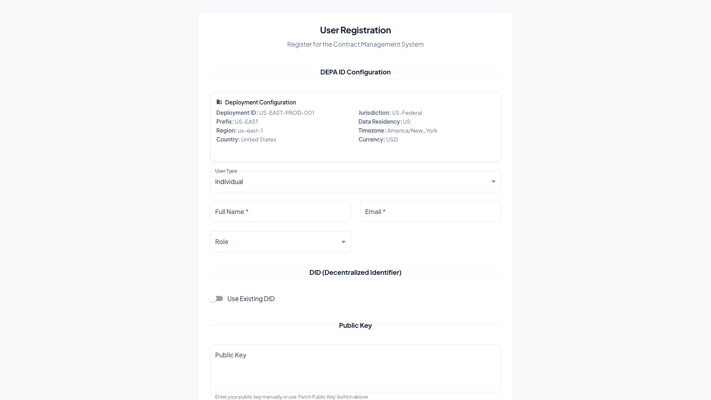
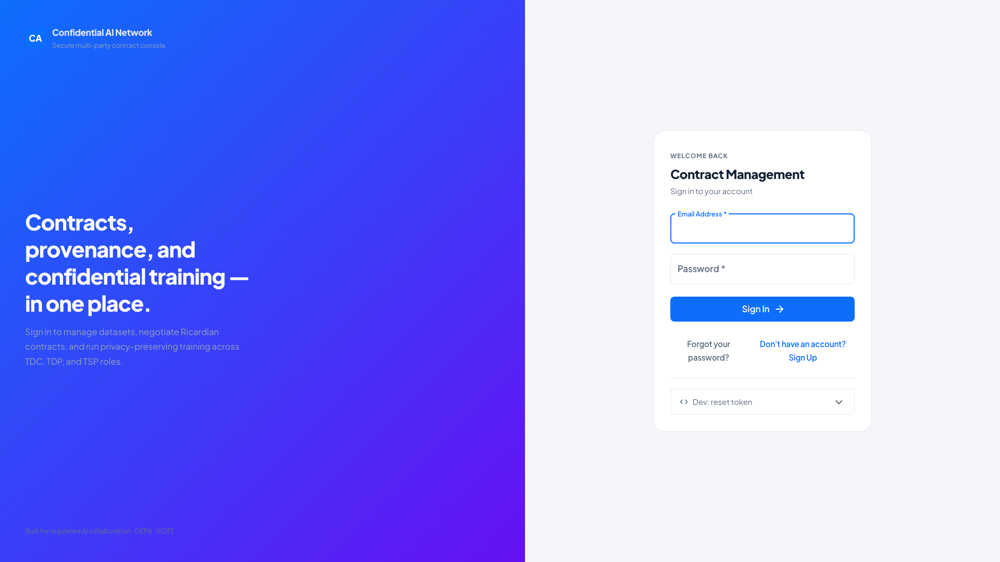
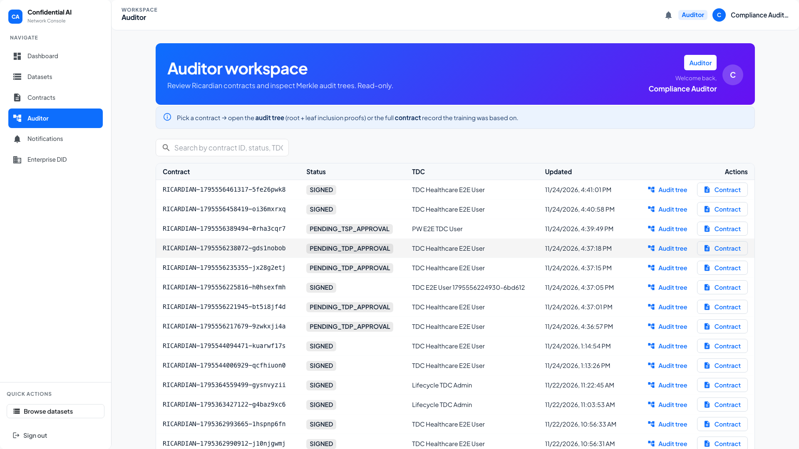
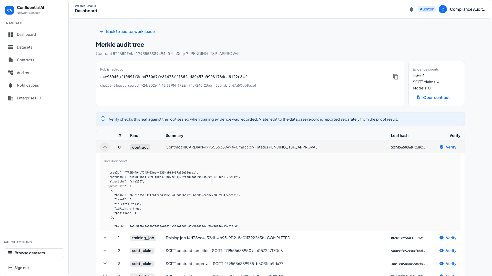
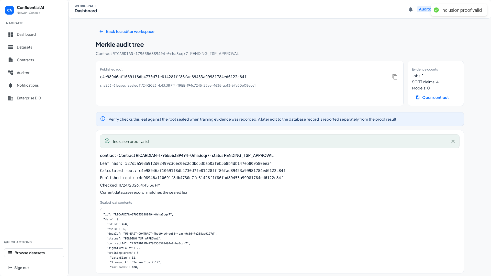
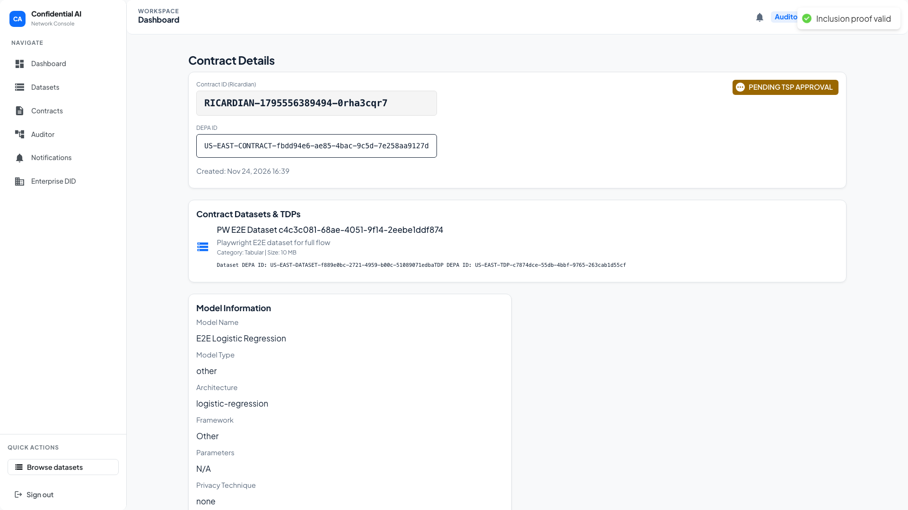

# Auditor User Guide — Contract and Merkle review

> Auto-generated by the Playwright E2E suite (`npm run test:e2e:auditor-guide` in `frontend/`).
> Screenshots refreshed: **2026-11-24**. Prefer regenerating over hand-editing images.

As an Auditor you review every Ricardian contract and the Merkle audit tree sealed for that contract. The workspace is read-only. You do not sign, train, deploy, or hold a data key or a model key.

## Who this is for

| | |
|---|---|
| Role | **Auditor** |
| Demo user | `auditor@example.com` |
| Password | `TestNewPassword123!` (local E2E seed only) |
| Access | Read-only. No contract signature, and no data key or model key |

## Register

The public form at `/register` lists **TDP**, **TDC**, and **TSP** only. An operator creates an Auditor with `POST /api/auth/register` and `partyType` `Auditor`, then the user signs in through Keycloak.

1. The operator sends name, email, and `partyType: Auditor`. A party signing key is not required.
2. Keycloak must be up. The email becomes the username.
3. Open **Login**, sign in, and set a password if this is the first login.
4. The auditor workspace is the next section. The demo user is `auditor@example.com`.

## Happy path

### 1. Sign in

1. Open **Login**.
2. Enter the auditor email and password. The local demo user is `auditor@example.com`.
3. Click **Sign In**. The first login can ask for a new password. The app then opens the auditor workspace.

### 2. Auditor workspace

The workspace lists every contract. Search by contract id, status, TDC name, or DEPA ID.
**Audit tree** opens the Merkle review. **Contract** opens the Ricardian record. Both are read-only.

### 3. Published root and leaves

This tree is for `RICARDIAN-1795556389494-0rha3cqr7`. **Published root** is the sealed root. The counts beside it are the training jobs, SCITT claims, and registered models.
Each row is one leaf: contract, training job, SCITT claim, or registered model. Expand a row to read the inclusion proof.

### 4. Verify a leaf

**Verify** checks that leaf against the sealed root.
The result shows the leaf hash, the calculated root, the published root, the check time, and whether the current database row still matches the sealed leaf. **Sealed leaf contents** is the payload that was hashed.

### 5. Contract review

**Open contract** shows the Ricardian contract the training used: parties, datasets, environment, and signatures.
**Merkle audit tree** on this page returns to the tree. This login cannot sign the contract or start training.

## Review sequence

1. Sign in. The app opens `/auditor/dashboard`.
2. Search by contract id, status, TDC name, or DEPA ID. Each row has **Audit tree** and **Contract**.
3. Open **Audit tree**. The page loads `GET /api/auditor/contracts/{id}/audit-tree`.
4. Read the root card. **Published root** means the root is sealed in `merkle_trees` with `tree_type = CONTRACT_AUDIT`. **Unsealed root** means the tree is computed from the current rows and a completed training job is not on the contract yet.
5. Read the evidence counts: training jobs, SCITT claims, and registered models.
6. Open a leaf. The kinds are `contract`, `training_job`, `scitt_claim`, and `ai_model`. The contract leaf stores status, legal document hash, Ricardian signature, parties, datasets, environment, and training parameters. A training leaf stores job status, times, metrics, and artifact hashes. A SCITT leaf stores the claim type and claim data. A model leaf stores the registered model id, name, framework, and architecture.
7. Click **Verify**. That calls `POST /api/auditor/verify-proof` with `{ contractId, nodeId }`. The page shows the sealed leaf, the leaf hash, the calculated root, the published root, the check time, and whether the current database row still matches the sealed leaf.
8. Click **Open contract** and review the Ricardian record. **Merkle audit tree** on that page returns to the tree. There is no Sign or Start training control on this path.

The root is written once. Registration of a model seals it. Opening the tree after a training job is `COMPLETED` seals it when no root exists yet. A later edit to the contract or the job does not replace that root. **Verify** still succeeds when the leaf sits under the saved root. The line **Current database record** says **matches the sealed leaf** or **differs from the sealed leaf**.

**Rebuild tree** reloads the same sealed root. It does not publish a second root.

A PII tombstone is `POST /api/auditor/provenance/{id}/tombstone` with `{ reason, redactedFields? }`. The Merkle leaf stays. The same id returns the first record. This write stays in this database. It is not an external filing. The workspace has no tombstone button.

AppAdmin can call the same `/api/auditor` routes. The screenshots in this guide are the Auditor login.

The check covers the contract, the training jobs, the SCITT claims stored for the contract, and the registered models. It records the evidence that was saved. A simulated attestation report stays simulated in that evidence. Owner key bytes are not in the leaves. The release record stores the time and the receipt, and the API does not keep the key.

## Related docs

- [Participant onboarding & E2E lifecycle](../PARTICIPANT_ONBOARDING_AND_E2E_LIFECYCLE.md)
- [Auditor role — API and seal rules](../../features/AUDITOR_ROLE.md)
- [Contract signing user guide](../../features/contract-signing/CONTRACT_SIGNING_USER_GUIDE.md)
- [Top-level user guide](../../USER_GUIDE.md)
- [Role user guides index](README.md)
