# TDC User Guide — Training Data Consumer

> Auto-generated by the Playwright E2E suite (`npm run test:e2e:user-guides` in `frontend/`).
> Screenshots refreshed: **2026-11-15**. Prefer regenerating over hand-editing images.

As a Training Data Consumer you browse datasets, create Ricardian contracts, wait for TDP+TSP signatures, and start training. A Local TSP runs on this machine. An Azure or GCP TSP submits to that TSP’s existing cluster. Your **party signing key** is created at registration (algorithm choice on `/register`).

## Who this is for

| | |
|---|---|
| Role | **TDC** |
| Demo user | `tdc.healthcare.2025-09-05t20-39-55@test.com` |
| Password | `TestNewPassword123!` (local E2E seed only) |
| Signing | Party signing key provisioned at **registration** (ECDSA-P256 default); used on contract **Sign** |

## Happy path

### 1. Sign in

1. Open the app and go to **Login**.
2. Enter your email and password.
3. Click **Sign In**. On first login you may be asked to set a new password.

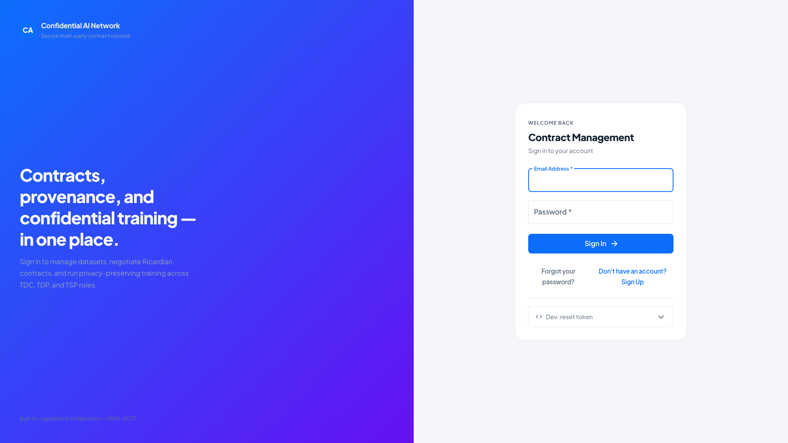

### 2. Dashboard

After login you land on the **TDC dashboard**: available datasets, your contracts, and quick status.

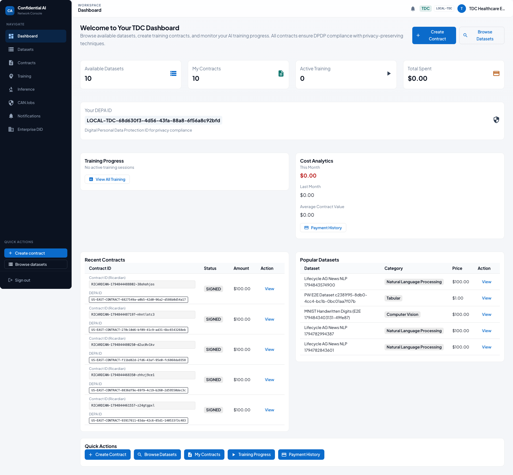

### 3. Browse datasets

Use **Datasets** to explore the catalog. Open a dataset for modality, size, and access details before contracting.

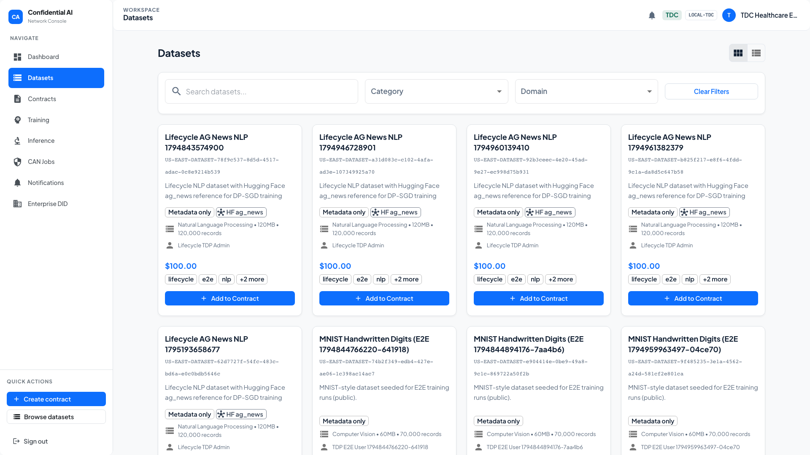

### 4. Contracts list

**Contracts** shows drafts, pending signatures, and active agreements you participate in.

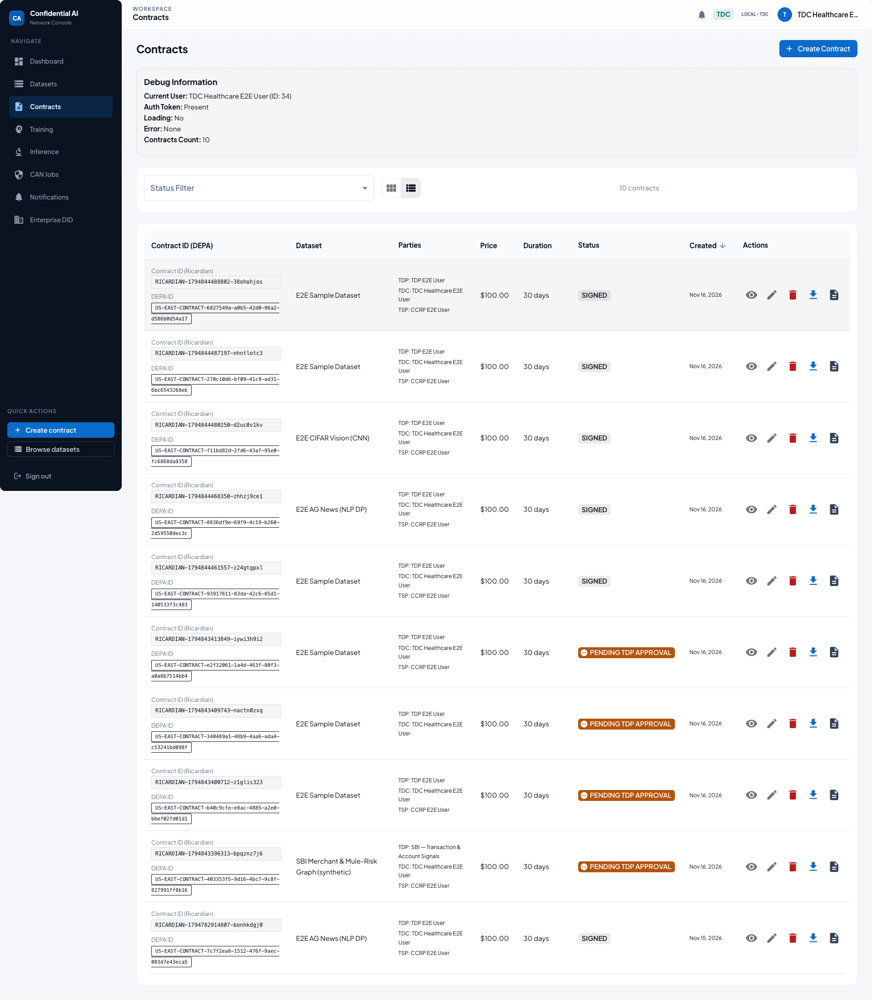

### 5. Create contract — Step 1: Select template

Open **Create contract** from the sidebar.
The wizard has five steps. Start by choosing a Ricardian **contract template**.

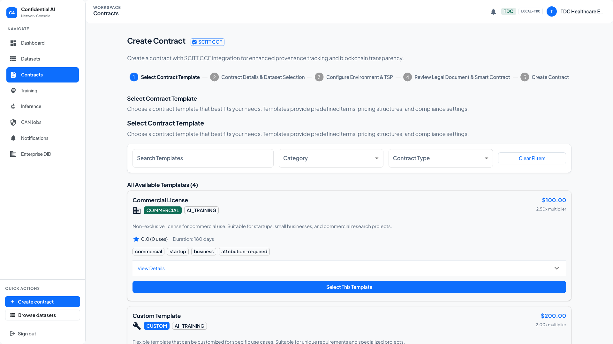

### 6. Create contract — Step 2: Details & datasets

Set price, duration, terms, and privacy/accuracy requirements.
Select **1–3 datasets** from Training Data Providers.

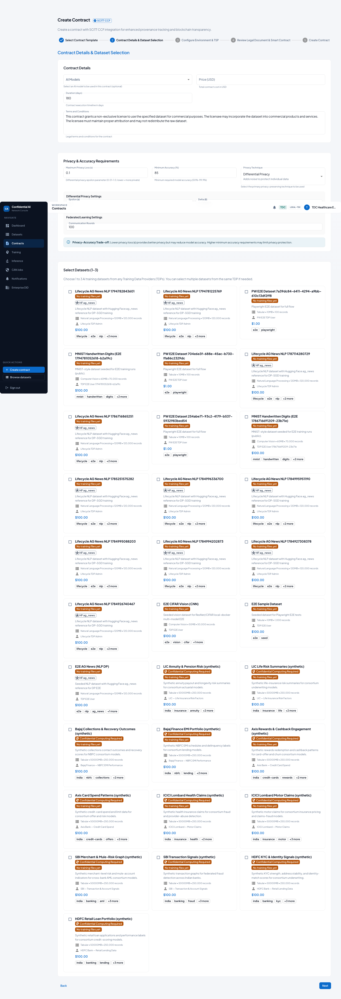

### 7. Create contract — Step 3: Environment & TSP

Filter **Cloud Provider** and select a **TSP**. That choice sets where training runs.
A **Local** TSP hides the cluster sections. An **Azure** TSP shows **Azure cluster** (Subscription ID, Resource group, AKS cluster name, Namespace, Region, Storage account, Key Vault URI). A **GCP** TSP shows **GCP cluster** (Project ID, Location, GKE cluster name, Namespace, GCS bucket).
Also set environment size and KMS. The kubeconfig path stays on the TSP dashboard **Cloud Provider** card.

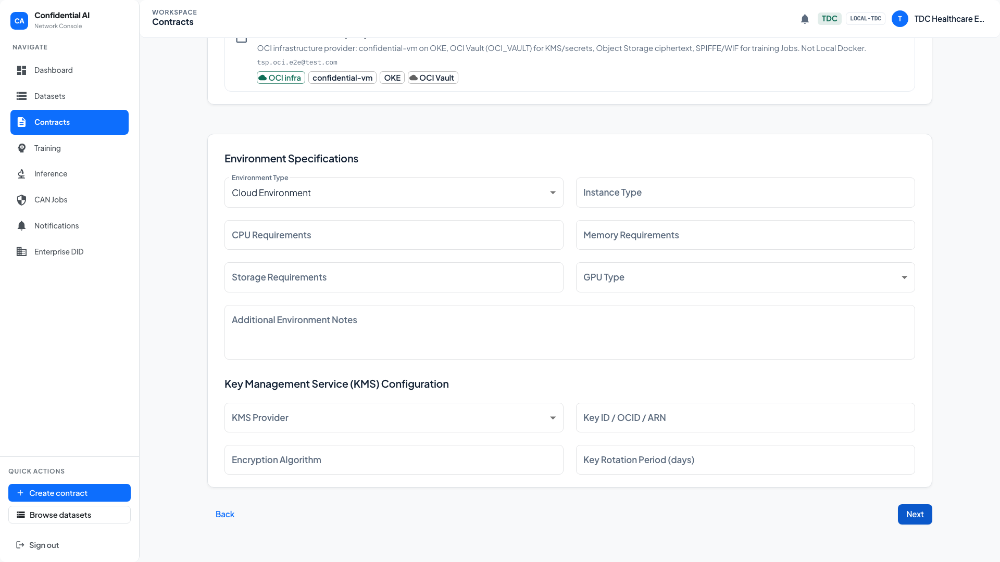

### 8. Create contract — Step 4: Review legal & smart contract

Review the generated legal document preview and smart-contract binding before creating the contract.

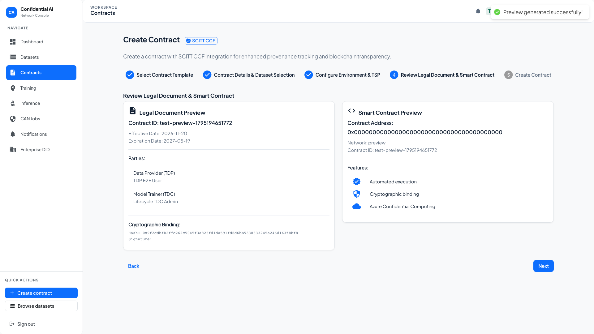

### 9. Create contract — Step 5: Submit

Confirm and click **Create Contract**. The contract enters **PENDING_TDP_APPROVAL** for dataset owners to sign.

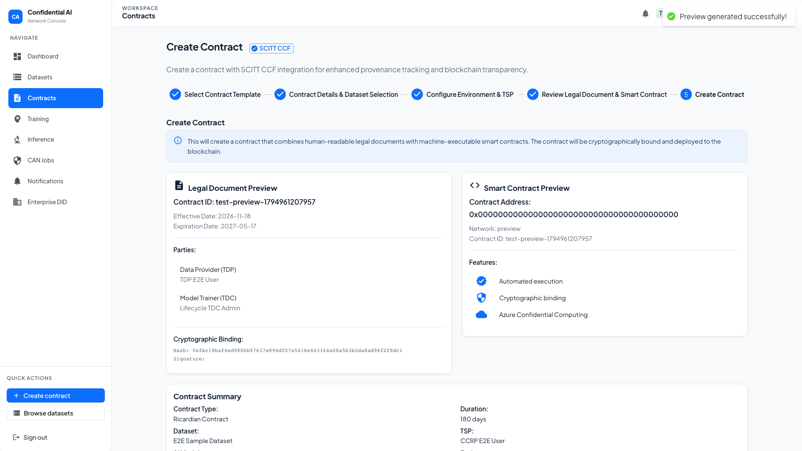

### 10. Signed contract (all participants)

After **TDP** and **TSP** both sign (each using their registration **party signing key**), the contract reaches **SIGNED**.
Only signed contracts can start training.

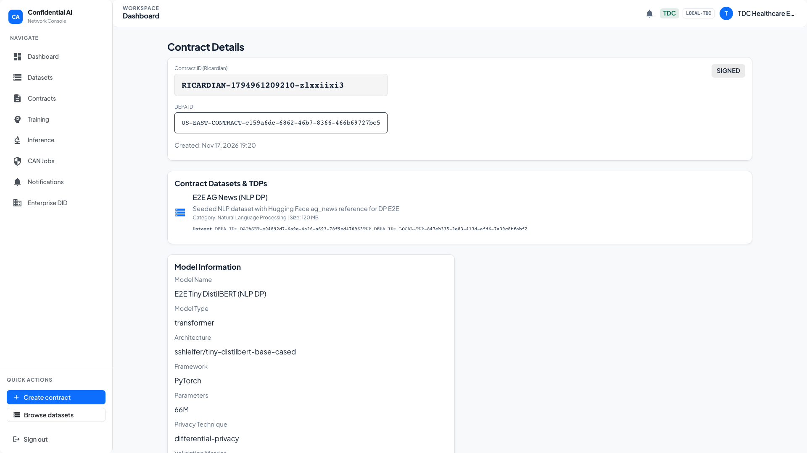

### 11. Local training execution

On **Training**, click **Start training** for a **SIGNED** contract. A Local TSP follows `TRAINING_EXECUTION_MODE` (`local-docker`, `local-native`, or `local-mlx`).
An Azure or GCP TSP submits to that TSP’s existing cluster (`azure-ccr` or `gcp-ccr`). Without a kubeconfig path the job is **FAILED** and no cluster is created. Completed local jobs show progress, privacy metrics when differential privacy is enabled, and artifact actions.

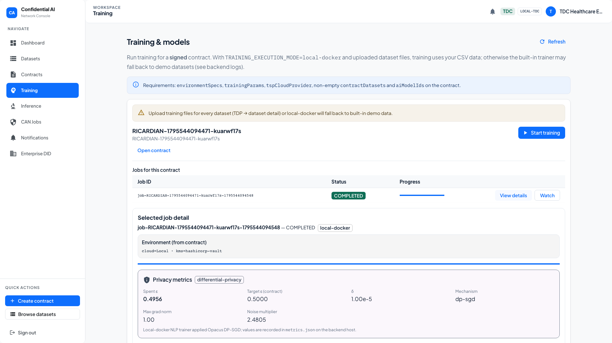

### 12. Training provenance report

Open **View job provenance** on a completed job to inspect the host/API provenance report (datasets, models, privacy metrics, artifact paths).
The same JSON is also available via the training provenance API and, for local-docker, as `provenance-report.json` next to `metrics.json`.

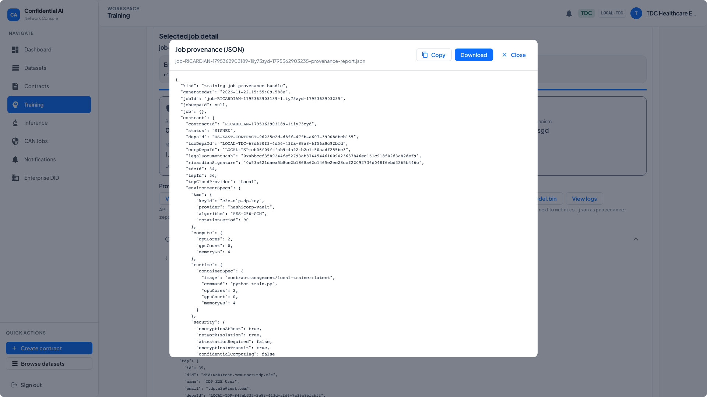

### 13. Training run logs

Use **View logs** to read the trainer/runner output for the job (container stdout/stderr captured by the local-docker runner).
This confirms the run executed against the signed contract inputs rather than a simulated placeholder.

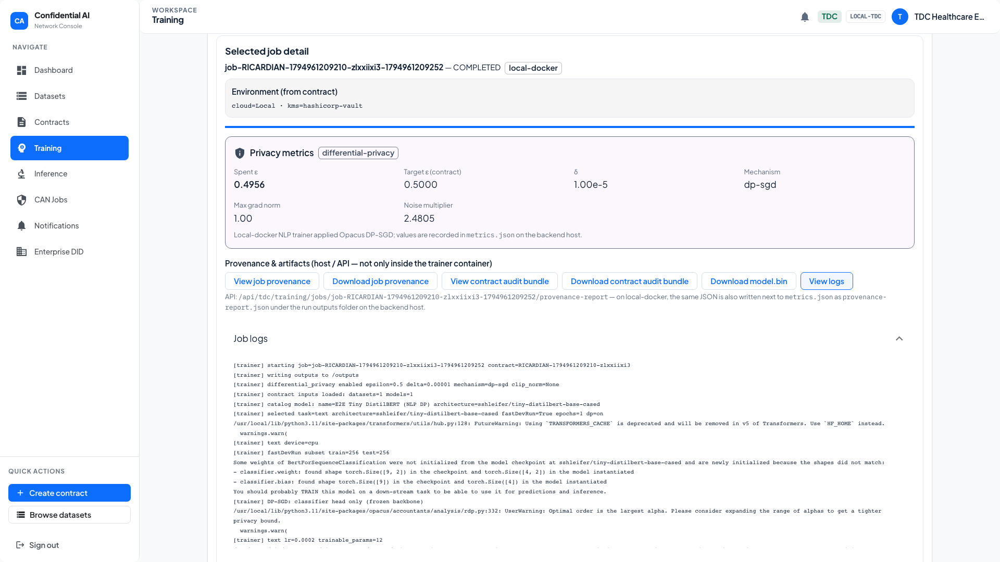

### 14. CAN jobs

**CAN Jobs** tracks confidential job coordination (escrow, attestation signals, release) for clean-room runs.

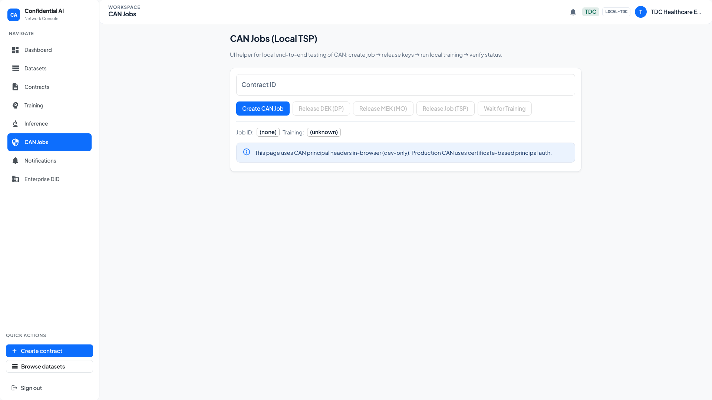

### 15. Notifications

**Notifications** surfaces signature requests, training updates, and system alerts.

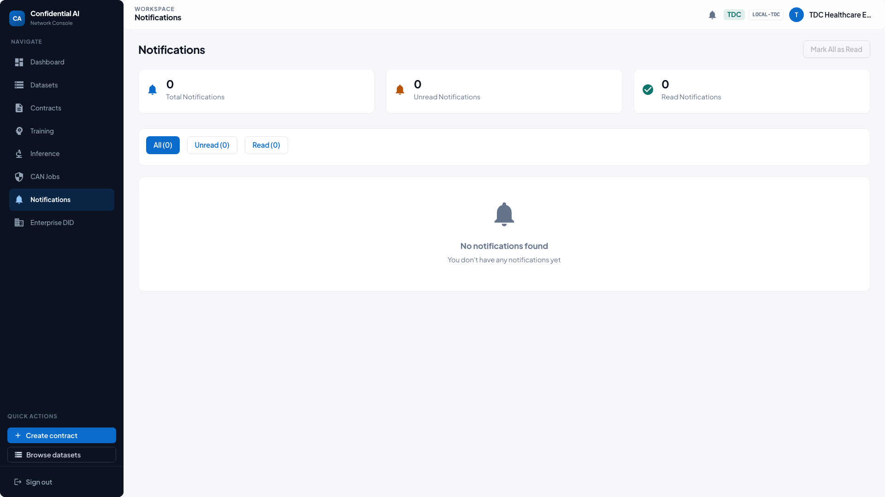

## Related docs

- [Participant onboarding & E2E lifecycle](../PARTICIPANT_ONBOARDING_AND_E2E_LIFECYCLE.md)
- [Contract signing user guide](../../features/contract-signing/CONTRACT_SIGNING_USER_GUIDE.md)
- [Top-level user guide](../../USER_GUIDE.md)
- [Role user guides index](README.md)
