# TDP User Guide — Training Data Provider

> Auto-generated by the Playwright E2E suite (`npm run test:e2e:user-guides` in `frontend/`).
> Screenshots refreshed: **2026-11-24**. Prefer regenerating over hand-editing images.

As a Training Data Provider you publish datasets, review incoming contracts, and **sign** with the party signing key created at registration.

## Who this is for

| | |
|---|---|
| Role | **TDP** |
| Demo user | `tdp.e2e@test.com` |
| Password | `TestNewPassword123!` (local E2E seed only) |
| Signing | Party signing key provisioned at **registration** (ECDSA-P256 default); used on contract **Sign** |

## Register

1. Open **Register** (`/register`) from the login page.
2. Choose **Individual** or **Enterprise**. Enterprise adds **Organization**.
3. Enter **Full Name** and **Email**. The email becomes the Keycloak username.
4. Set **Role** to **Training Data Provider (TDP)**.
5. Leave **Use Existing DID** off unless you already have a `did:web` or `did:ethr`. The system assigns a DID and a DEPA ID (`TDP-…`).
6. **Public Key** and wallet connection are optional. They are not the party signing key.
7. Under **Party signing key**, keep **ECDSA-P256** unless you need RSA-2048 or RSA-4096. Registration creates that key. You use it later to sign a contract.
8. Click **Register**. Keycloak must be up. On success, choose **Go to Login Page**. The first login can ask you to set a password.
9. After login, publish a dataset. That is the next section.

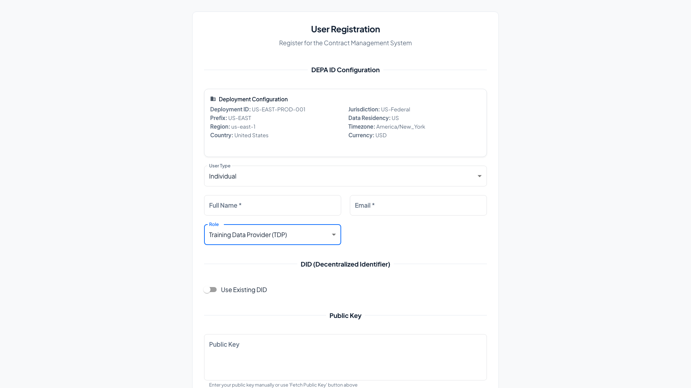

## Happy path

### 1. Sign in

1. Open the app and go to **Login**.
2. Enter your email and password.
3. Click **Sign In**. On first login you may be asked to set a new password.

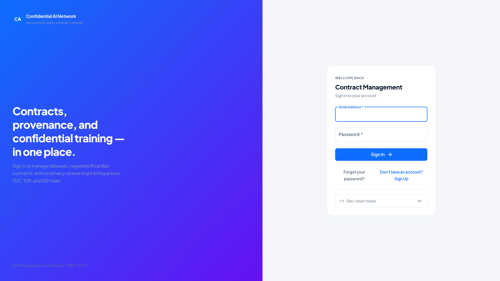

### 2. Dashboard

The **TDP dashboard** summarizes your datasets, contract activity, and outstanding actions.

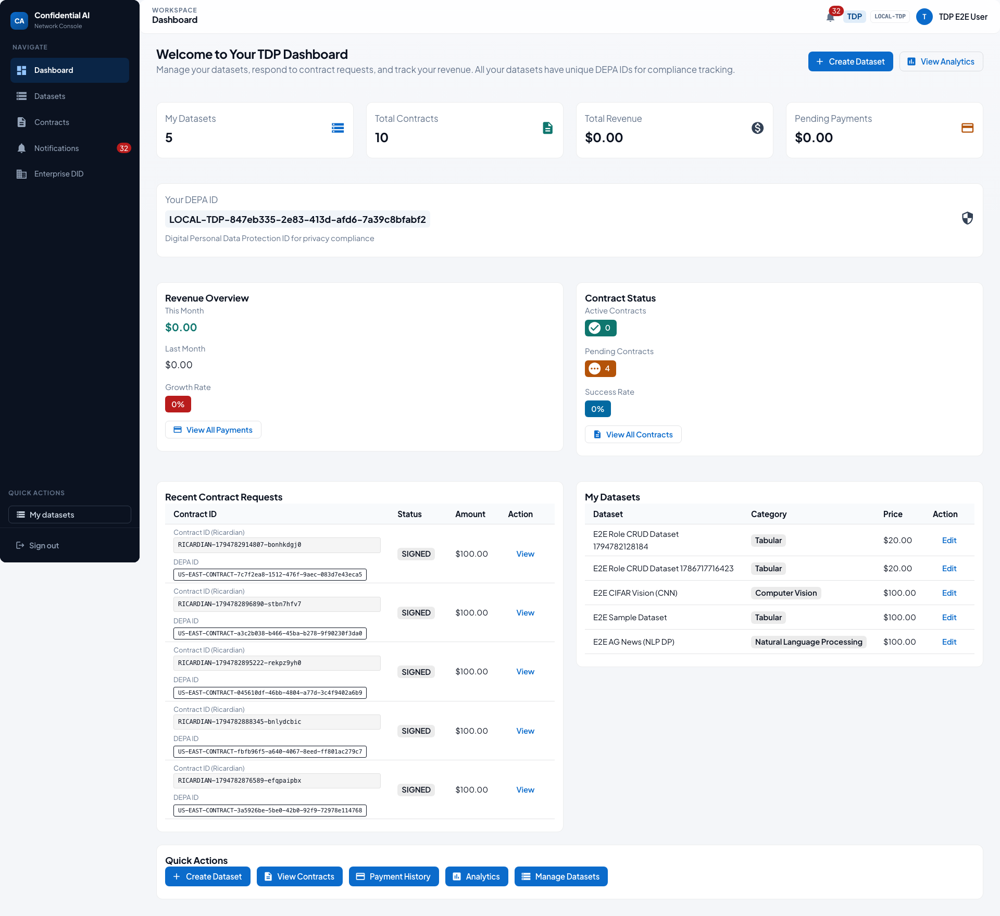

### 3. My datasets

**Datasets** lists assets you own. Review metadata, visibility, and DEPA identifiers before sharing.

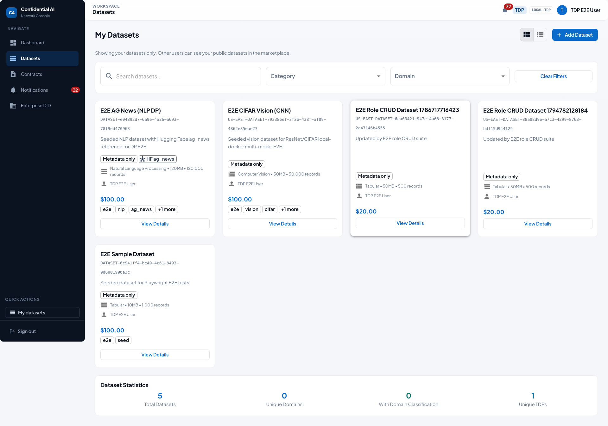

### 4. Publish a dataset

Open **Datasets** and choose **Add dataset** (`/datasets/add`). The page is **Add New Dataset**. Move with **Next**. **Back** returns to the previous step. **Cancel** leaves without saving. The last step publishes the catalog entry.

1. **Basic Information.** Enter **Dataset Name**, **Description**, and **Category**. These three are required. Set **License** here (for example MIT, Apache 2.0, or Commercial). Add tags if you want them.

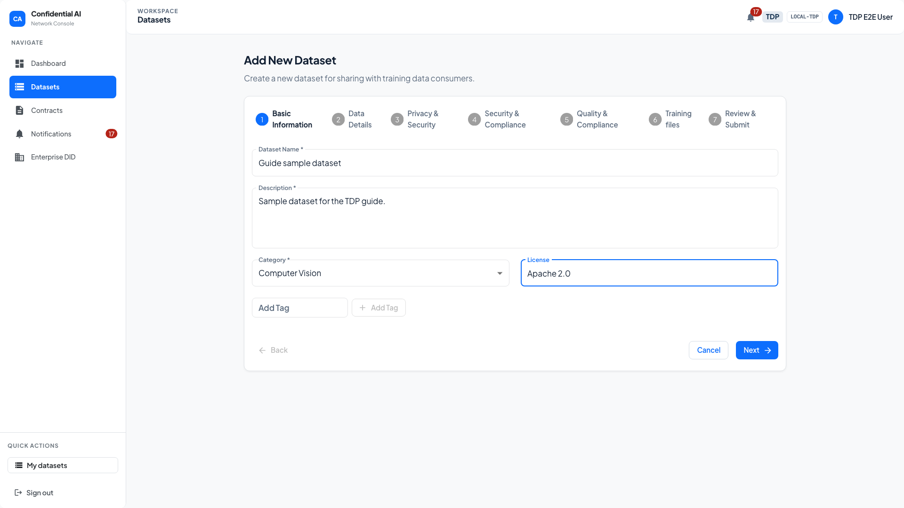

2. **Data Details.** Enter **Dataset Size**, **Record Count**, and **Data Format**. These three are required. **Data Source**, **Collection Method**, **Update Frequency**, and **Retention Period** are optional. Turn on **Link to Hugging Face Hub dataset** only when you want a catalog pointer for local Docker training. That switch does not upload the data.

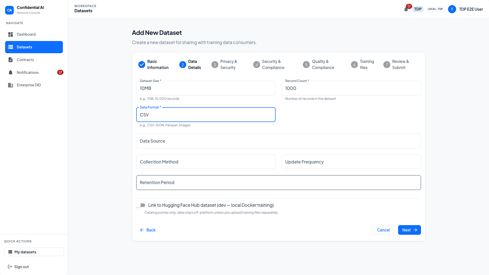

3. **Privacy & Security.** Choose at least one **Privacy Technique**. That choice is required. Set **Access Restrictions** here (for example role-based or time-based). **Confidential Computing Required**, **Data Anonymization Level**, and **Encryption Required** are on this step.

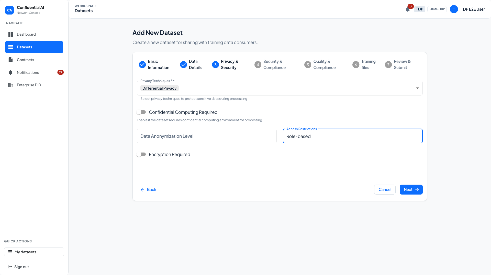

4. **Security & Compliance.** Choose **Data Classification** (Public, Internal, Confidential, Restricted, or Top Secret). Classification sets the recommended access controls. Then set **Encryption Algorithm** (AES-256-GCM is the default), **Data Residency Region**, and **Processing Location**. The processing location must be allowed for the residency region. Switches on this step: **Secure Enclave Required**, **Attestation Required**, **Encryption at Rest**, **Encryption in Transit**, and **Cross-Border Transfer Allowed**. Secure enclave and attestation stay off for Public and Internal.

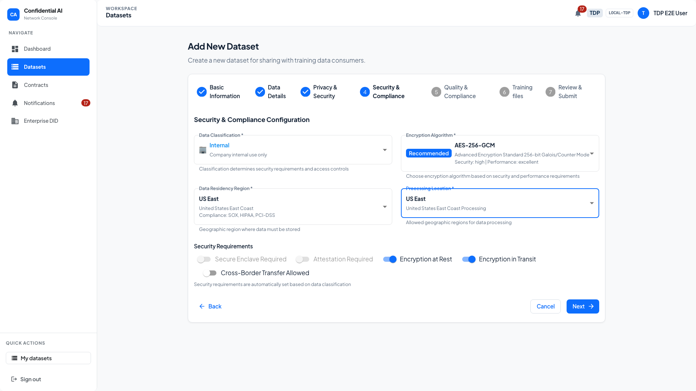

5. **Quality & Compliance.** Select **Quality Metrics** and **Compliance Requirements**. **Data Governance** and **Audit Trail Required** are optional.

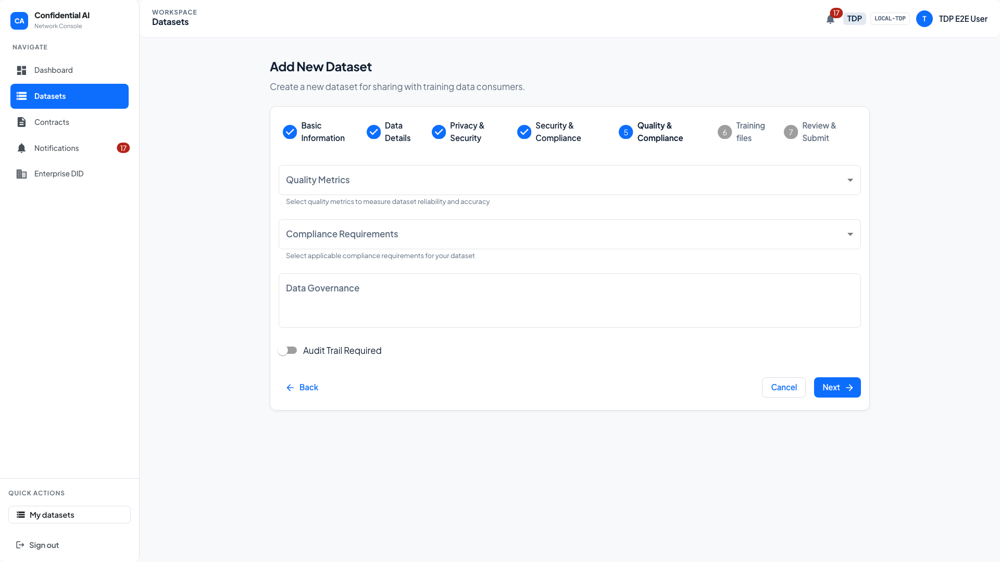

6. **Training files.** Optional. Choose **Artifact format hint** (CSV for tabular) and **Choose files**. Tabular files use numeric columns and an integer label in the last column. Pickle, joblib, and `.pt` / `.pth` files are rejected. You can upload later from the dataset page.

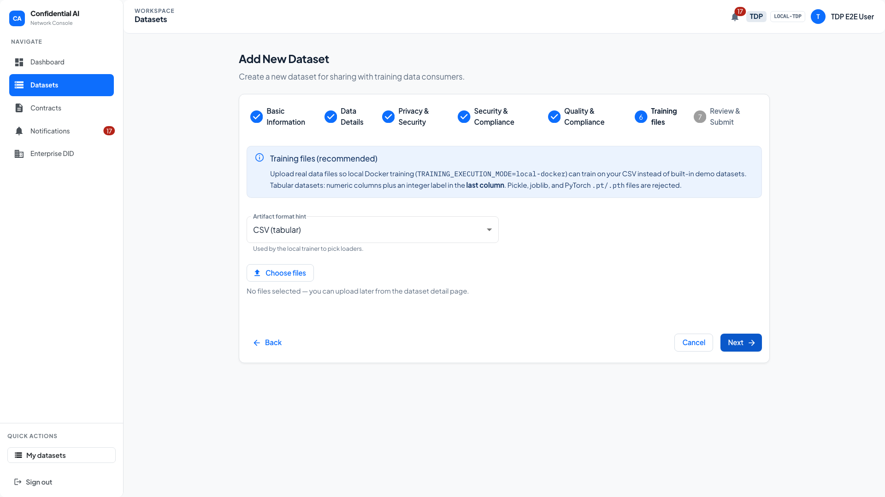

7. **Review & Submit.** Check the summary, including license, access, classification, and queued files. **Pricing** and **Contact Information** are optional. Click **Create Dataset**. The catalog row is created, any queued files upload, and you return to **Datasets**. The screenshot stops before that button so the guide does not publish a sample row.

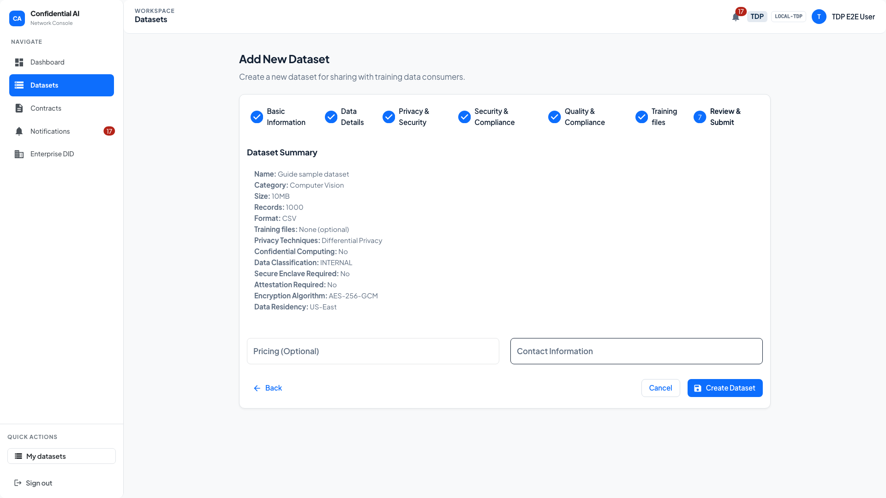

### 5. Contracts awaiting signature

Open **Contracts** to see agreements that use your datasets.
Pending items show status **PENDING_TDP_APPROVAL**. Use the pen / **Sign Contract** action to open the detail page.

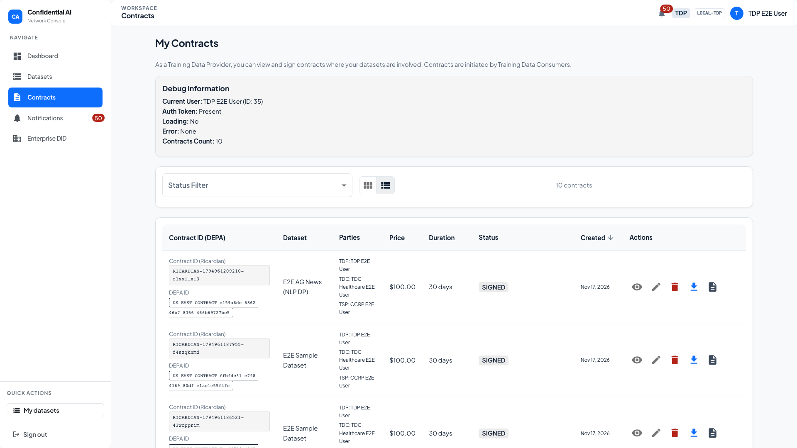

### 6. Sign contract as TDP

On **Contract Details**, review terms, datasets, and DEPA IDs.
Use **Sign Contract as TDP** in the Actions panel (or **Sign** next to your dataset row).
Signing uses the **party signing key** created when you registered (algorithm on `/register`).
After you sign, status moves to **PENDING_TSP_APPROVAL** for the clean-room provider.

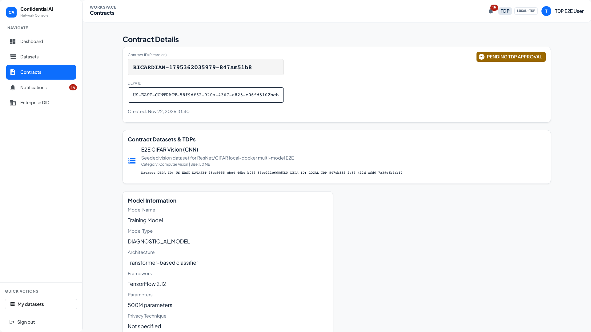

### 7. Notifications

Watch for signature requests and dataset access events here.

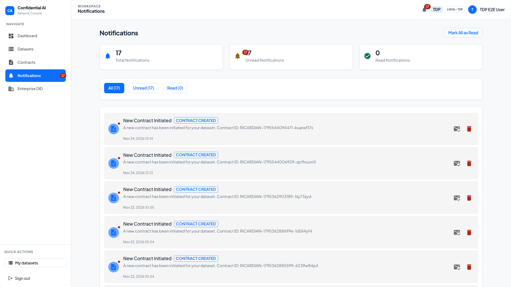

## Signing and data keys

Your party signing key is created at registration (**ECDSA-P256** unless you choose RSA). Sign the contract with that key. A dataset row can record AES-256-GCM and an optional `encryption_key_id`. Platform encryption holds that key on the platform. A principal-held data key is not uploaded here. When a contract uses this dataset, the clean room asks your Key Broker for the data key. The catalog key id is not that broker. The model publisher is a separate call, and the tech service provider hosts the room. The join is [Datasets, models, and the clean room](../../USER_GUIDE.md#datasets-models-and-the-clean-room).

## Related docs

- [Participant onboarding & E2E lifecycle](../PARTICIPANT_ONBOARDING_AND_E2E_LIFECYCLE.md)
- [Contract signing user guide](../../features/contract-signing/CONTRACT_SIGNING_USER_GUIDE.md)
- [Top-level user guide](../../USER_GUIDE.md)
- [Role user guides index](README.md)
