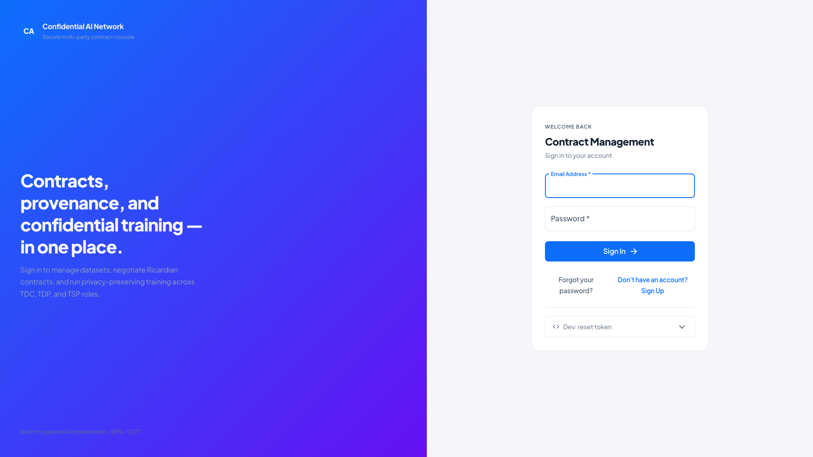
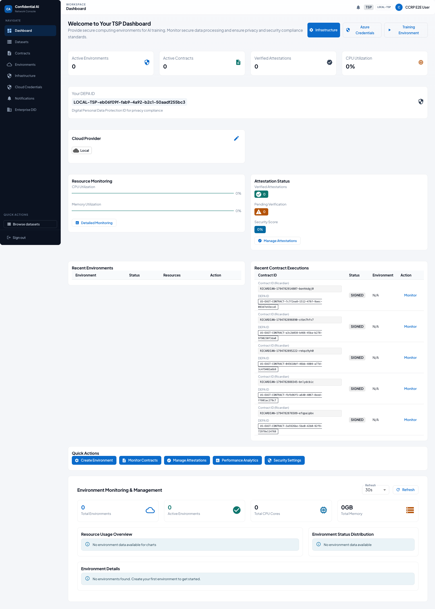
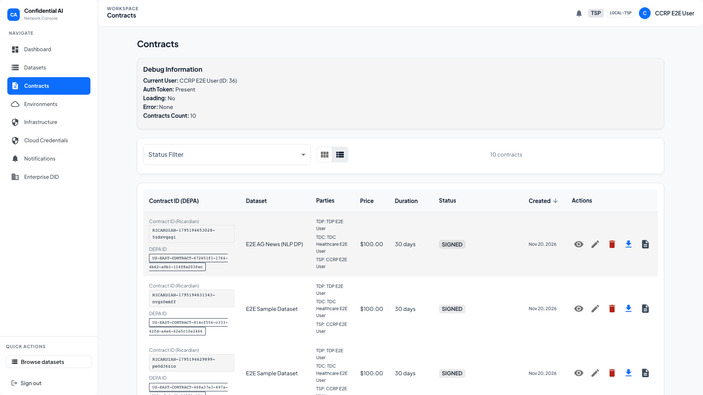
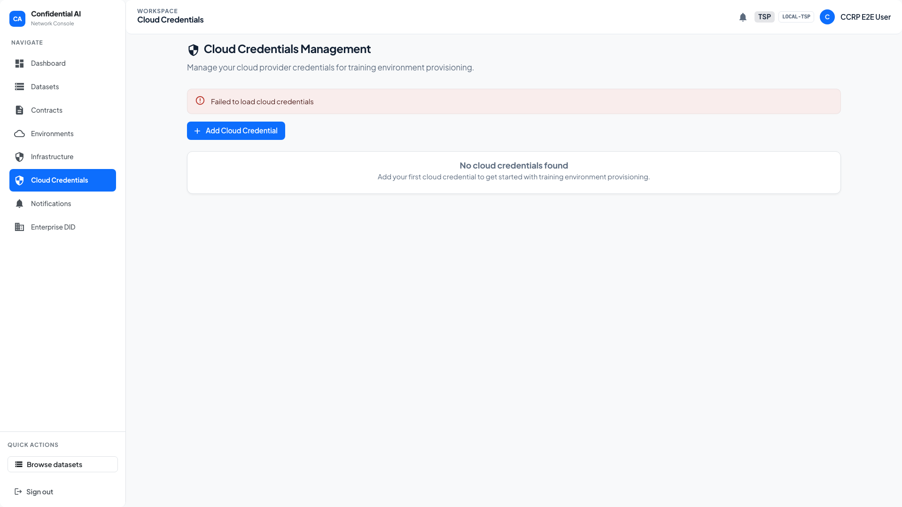
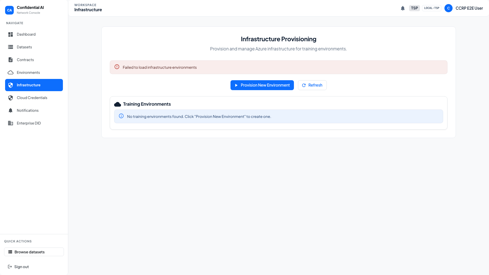
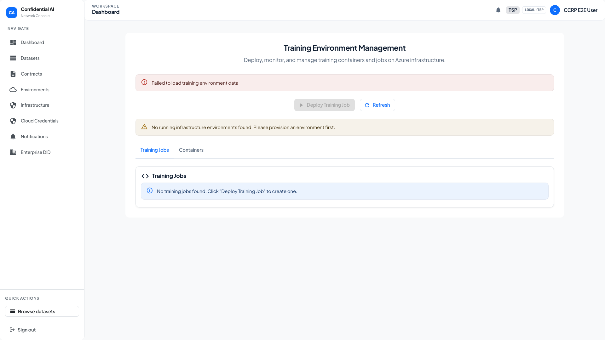
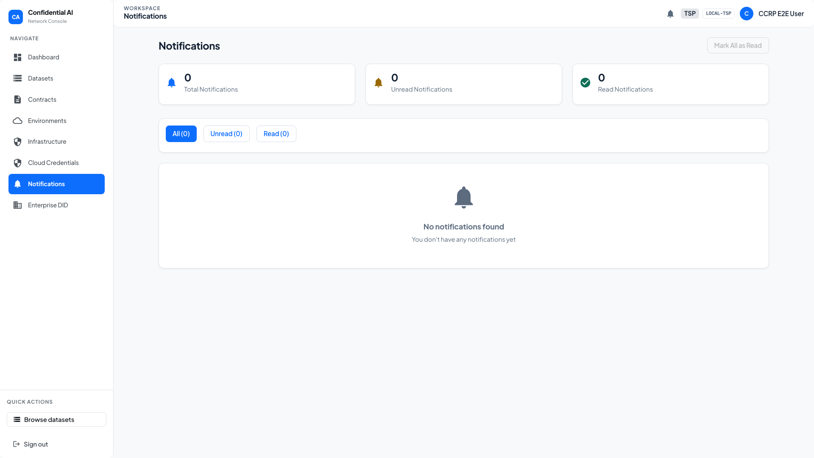

# TSP / CCRP User Guide — Tech Service Provider

> Auto-generated by the Playwright E2E suite (`npm run test:e2e:user-guides` in `frontend/`).
> Screenshots refreshed: **2026-11-15**. Prefer regenerating over hand-editing images.

As a Tech Service Provider (also called CCRP in older docs) you host confidential training on a Local machine or on your existing Azure or GCP cluster. Save the cluster and kubeconfig path on the dashboard **Cloud Provider** card, and **co-sign** contracts with the party signing key from registration.

## Who this is for

| | |
|---|---|
| Role | **TSP** |
| Demo user | `ccrp.e2e@test.com` |
| Password | `TestNewPassword123!` (local E2E seed only) |
| Signing | Party signing key provisioned at **registration** (ECDSA-P256 default); used on contract **Sign** |

## Happy path

### 1. Sign in

1. Open the app and go to **Login**.
2. Enter your email and password.
3. Click **Sign In**. On first login you may be asked to set a new password.

### 2. Dashboard

The **TSP dashboard** shows environment health, contracts that need your signature, and the **Cloud Provider** card.
Edit that card to choose Local, Azure, or GCP. Azure asks for Subscription ID, Resource group, AKS cluster name, Namespace, Region, Storage account, Key Vault URI, and Kubeconfig path. GCP asks for Project ID, Location, GKE cluster name, Namespace, GCS bucket, and Kubeconfig path.
Training uses this existing cluster. The kubeconfig path is a file on this host.

### 3. Contracts

Confirm clean-room requirements (TEE / residency / policies), then **Sign** when you can host the job.
Signing uses the **party signing key** created at registration (same ECDSA-P256 / RSA choice as TDP/TDC).

### 4. Cloud credentials

**Cloud credentials** stores provider login material used when creating environments. The cluster name and kubeconfig path used by Azure and GCP training are saved on the dashboard **Cloud Provider** card.

### 5. Infrastructure

**Infrastructure** / provisioning views cover capacity and environment setup for training runs.

### 6. Training environment

Monitor or configure the **training environment** used for local Docker or cloud CCR sessions.

### 7. Notifications

Signature requests and provisioning alerts appear under **Notifications**.

## Related docs

- [Participant onboarding & E2E lifecycle](../PARTICIPANT_ONBOARDING_AND_E2E_LIFECYCLE.md)
- [Contract signing user guide](../../features/contract-signing/CONTRACT_SIGNING_USER_GUIDE.md)
- [Top-level user guide](../../USER_GUIDE.md)
- [Role user guides index](README.md)
