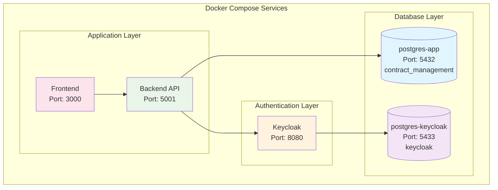

# Secrets Management Guide

`secrets.env` is the secret file for a laptop or a single local VM. A cluster reads the cloud secret store. `config.env` is committed, so secret values stay out of it.

## Overview

- **Public configuration** goes in `config.env` at the repository root. This file is tracked.
- **Local secrets** go in `secrets.env`. It is gitignored. Set its mode to `600`.
- **`./start-system.sh` and the API** read both files on a local machine.
- **A cluster** receives database and identity secrets from the cloud store through External Secrets. The pod still sees them as environment variables. The source is the store, not a copied `secrets.env`.

The parameter list is [the deployment hub](../deployment/README.md). The cluster rule is [multi-cloud pattern P6](../production/MULTI_CLOUD_SECURITY_ARCHITECTURE_PATTERNS.md).

## Database Architecture

The system uses **two separate PostgreSQL instances**:

1. **`postgres-app`** (Application Database)
   - Port: 5432
   - Database: `contract_management`
   - User: `postgres`
   - Used by: Backend API, application data

2. **`postgres-keycloak`** (Keycloak Database)
   - Port: 5433
   - Database: `keycloak`
   - User: `keycloak`
   - Used by: Keycloak authentication service

This separation provides:
- **Security isolation** between application and authentication data
- **Independent scaling** of databases
- **Clear separation of concerns**
- **Easier backup and maintenance**

### Database Architecture Diagram



## File Structure

```
├── config.env              # Public configuration (tracked in git)
├── config.env.example      # Template for public configuration
├── secrets.env.example     # Template for secrets (tracked in git)
├── secrets.env             # Actual secrets (do not commit)
├── .env                    # Combined file for Docker Compose (NOT tracked in git)
└── setup-environment.sh    # Setup script
```

## Quick Start

1. **Run the setup script:**
   ```bash
   ./setup-environment.sh
   ```

2. **Edit your secrets:**
   ```bash
   nano secrets.env
   ```

3. **Test your configuration:**
   ```bash
   docker-compose -f docker-compose.dev.yml config
   ```

## Configuration Files

### `config.env` - Public Configuration
Contains non-sensitive configuration that can be safely committed to git:
- Database host/port/name
- Service URLs
- Feature flags
- Log levels
- Port mappings

### `secrets.env.example` - Secrets Template
Template file showing what secrets are needed:
- Database passwords
- JWT secrets
- API keys
- Admin passwords
- Vault tokens

### `secrets.env` - Actual Secrets
Your local secrets file (created by setup script):
- Contains actual secret values
- **NEVER commit this file to git**
- Used for local development

### `.env` - Combined Configuration
`./start-system.sh` and the API read `config.env` and `secrets.env` directly. Some Docker Compose commands also look for a combined `.env`:
- Used by Docker Compose
- **NEVER commit this file to git**
- Regenerated by setup script

## Security Best Practices

### ✅ DO:
- Use `secrets.env` for actual secrets
- Keep `config.env` for public configuration
- Run `./setup-environment.sh` to set up environment
- Test configuration with `docker-compose config`
- Use strong, unique secrets in production

### ❌ DON'T:
- Commit `secrets.env` to git
- Commit `.env` to git
- Put secrets in `config.env`
- Use default/example secrets in production
- Share `secrets.env` files

## Environment Variables

### Database Configuration
```bash
# Public (config.env)
# Application Database (postgres-app)
DB_HOST=localhost
DB_PORT=5432
DB_NAME=contract_management
DB_USER=postgres

# Keycloak Database (postgres-keycloak)
KEYCLOAK_DB_PORT=5433
KEYCLOAK_DB_NAME=keycloak
KEYCLOAK_DB_USER=keycloak

# Secrets (secrets.env)
DB_PASSWORD=your-app-db-password
KEYCLOAK_DB_PASSWORD=your-keycloak-db-password
```

### Keycloak Configuration
```bash
# Public (config.env)
KEYCLOAK_URL=https://localhost:8443
KEYCLOAK_REALM=contract-management
KEYCLOAK_CLIENT_ID=contract-management-frontend
KEYCLOAK_ADMIN_USER=admin

# Secret (secrets.env)
KEYCLOAK_CLIENT_SECRET=your-client-secret
KEYCLOAK_ADMIN_PASSWORD=your-admin-password
```

### JWT Configuration
```bash
# Public (config.env)
JWT_EXPIRES_IN=24h

# Secret (secrets.env)
JWT_SECRET=your-super-secure-jwt-secret
```

## Docker Compose Integration

Docker Compose automatically loads environment variables from:
1. `.env` file (auto-generated)
2. `env_file` directives in services
3. `environment` sections in services

### Service Configuration
```yaml
services:
  backend:
    env_file:
      - config.env
      - secrets.env
    environment:
      NODE_ENV: ${NODE_ENV}
      PORT: ${PORT}
      DB_PASSWORD: ${DB_PASSWORD}
      JWT_SECRET: ${JWT_SECRET}
```

## Cluster secrets

Keep `JWT_SECRET`, `DATA_ENCRYPTION_KEY`, database passwords, and identity client secrets in the cloud store once more than one machine runs the API. A copy of `DATA_ENCRYPTION_KEY` next to a database backup decrypts the data that key protects.

| Target | Store | How the API receives it |
|--------|--------|-------------------------|
| Local | `secrets.env` | `./start-system.sh` loads the file |
| Azure | Key Vault | `deployment/azure/scripts/install-external-secrets.sh` syncs `can-{env}-db-connection` and `can-{env}-entra-api-client-secret`. The script exits when the vault or the cluster is missing. Workload identity is the vault login. |
| Google Cloud | Secret Manager | External Secrets, as in the [GCP security architecture](../production/GCP_SECURITY_ARCHITECTURE.md) |
| AWS | Secrets Manager | External Secrets, as in the [AWS security architecture](../production/AWS_SECURITY_ARCHITECTURE.md) |
| OCI | OCI Vault | External Secrets, as in the [OCI security architecture](../production/OCI_SECURITY_ARCHITECTURE.md) |

Signing follows the same switch. The default `SIGNING_KEY_BACKEND` is `database`. `azure-keyvault` or `azure-mhsm` keeps the private key in Key Vault. `terraform.tfvars` holds `db_password` for the operator machine and stays uncommitted.

## Troubleshooting

### Missing Environment Variables
```bash
# Check if .env file exists
ls -la .env

# Regenerate .env file
./setup-environment.sh

# Test configuration
docker-compose -f docker-compose.dev.yml config
```

### Secrets Not Loading
```bash
# Check secrets file exists
ls -la secrets.env

# Verify secrets are in .env
grep "DB_PASSWORD" .env

# Check Docker Compose logs
docker-compose -f docker-compose.dev.yml logs backend
```

### Configuration Validation
```bash
# Validate Docker Compose syntax
docker-compose -f docker-compose.dev.yml config

# Check for missing variables
docker-compose -f docker-compose.dev.yml config 2>&1 | grep "not set"
```

## Migration from Old Configuration

If you have existing configuration files:

1. **Backup existing config:**
   ```bash
   cp config.env config.env.backup
   ```

2. **Run setup script:**
   ```bash
   ./setup-environment.sh
   ```

3. **Move secrets to secrets.env:**
   ```bash
   # Edit secrets.env with your actual values
   nano secrets.env
   ```

4. **Remove secrets from config.env:**
   ```bash
   # Remove lines like:
   # DB_PASSWORD=postgres
   # JWT_SECRET=your-secret
   ```

5. **Test configuration:**
   ```bash
   docker-compose -f docker-compose.dev.yml config
   ```

## File Permissions

Ensure proper file permissions:
```bash
# Make setup script executable
chmod +x setup-environment.sh

# Secure secrets file
chmod 600 secrets.env
chmod 600 .env
```

## Git Integration

The following files are in `.gitignore`:
- `secrets.env` - Your local secrets
- `.env` - Combined configuration
- `*.secrets` - Any secrets files

The following files are tracked in git:
- `config.env` - Public configuration. Secret values do not belong here.
- `config/examples/config.env.example` - Configuration template
- `secrets.env.example` - Secrets template, with empty values

This ensures that:
- ✅ Configuration templates are shared
- ✅ Actual secrets stay local
- ✅ No sensitive data is committed
- ✅ Easy setup for new developers
